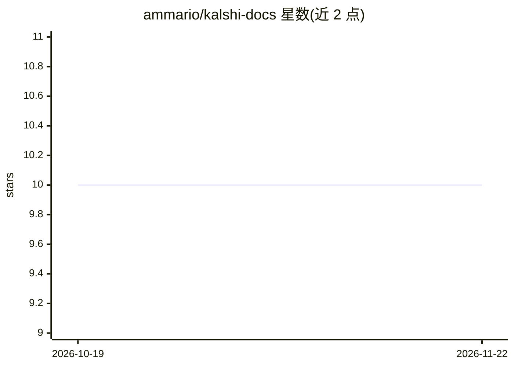

# ammario/kalshi-docs

⭐ 10 · TypeScript · CC0-1.0 · 推送 2026-11-21 · [GitHub](https://github.com/ammario/kalshi-docs) · 个人维护

**给 AI 编码代理用的 Kalshi API 文档 Markdown 仓库**

自动化仓库，按 sitemap 抓取并归档全部 Kalshi API 文档为 Markdown，通过 GitHub Actions 每晚更新。可作为 Agent Skill 安装到 20+ 种 AI 编码代理，也可作为 git submodule 引入，文档按章节目录组织。采用 CC0-1.0 许可发布。

## 筛选速览

| 维度 | 判定 | 备注 |
|---|---|---|
| AI 角色 | `ai-knowledge` | 知识聚合/清单类 |
| 许可风险 | `viral` | CC0-1.0 |
| 部署形态 | `library` | 以包/库形式分发 |
| 模型依赖 | — | README 未给出锁定关系 |
| 硬件要求 | — | 无带数字的原话,不猜 |
| 安装摩擦 | `low` | 无编译、无系统依赖或容器化 |
| 成熟度 | — | 结构信号不足 |

## 能力要点

- 每夜自动同步 Kalshi 官方文档为 Markdown
- npx add-skill 一条命令安装为 Agent Skill
- 支持 Mux、Claude Code、Cursor 等 20+ 代理
- CC0-1.0 公共领域许可

## 适用场景

- 让 AI 编码代理直接读取 Kalshi API 文档生成代码
- 以 git submodule 形式为项目引入 Kalshi 文档

## 场景标签

 · 领域:开发者工具/API 文档知识库

## 证据(README 行号)

> L6: An automated repository that downloads and archives all Kalshi documentation from their sitemap as markdown.
> L14: Install as an Agent Skill for AI coding agents:
> L20: Supports Mux, Claude Code, Cursor, Codex, OpenCode, and 20+ other agents.

## 星数曲线

2026-10-19 10 → 2026-11-22 10（+0）

---
*卡片 v1 · prompt 1.4 · 生成 2026-11-20 · 置信度 high · 依据 README sha `1a7f022e0e32` · [字段定义](../../DATASET.md)*
