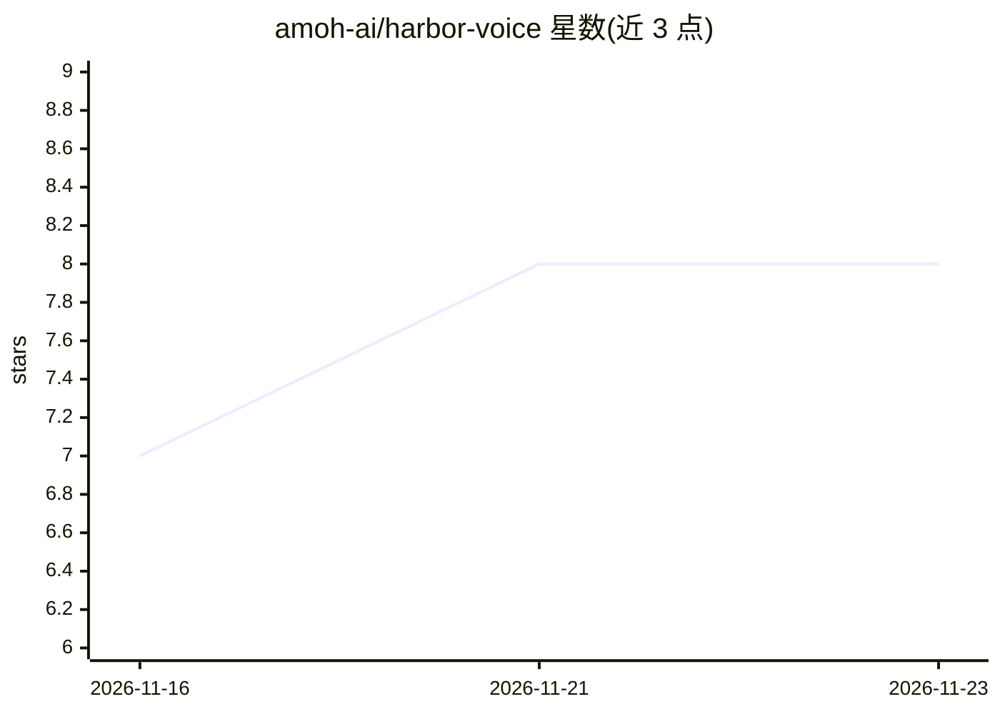

# amoh-ai/harbor-voice

⭐ 8 · Python · Apache-2.0 · 推送 2026-11-17 · [GitHub](https://github.com/amoh-ai/harbor-voice) · [官网](https://pypi.org/project/harbor-voice/) · 组织维护

**以实时通话方式评测语音 agent 的基准运行库**

harbor-voice 在 Harbor 基础设施上扩展语音 agent 评测：每个基准任务以一次 Harbor trial 形式运行为实时通话，内置六层可种子化的模拟来电者（persona、语音、环境、信道、对话、工具）与被测 agent 进行 20 ms 全双工音频交互；内置 τ-Voice（278 任务）与 EVA（213 任务）两个基准的固定数据集，每次通话产出 ATIF-voice 轨迹、录音、指标与有效性报告，可用于评测或作为 RL rollout。被测 agent 可为 OpenAI、Google、Amazon 等的语音到语音模型，或自建的级联管线，也可自托管。

## 筛选速览

| 维度 | 判定 | 备注 |
|---|---|---|
| AI 角色 | `ai-ecosystem` | LLM/agent 周边工具 |
| 许可风险 | `permissive` | Apache-2.0 |
| 部署形态 | `library` | 以包/库形式分发 |
| 模型依赖 | local-ok | 支持本地模型 |
| 硬件要求 | — | 无带数字的原话,不猜 |
| 安装摩擦 | `low` | 无编译、无系统依赖或容器化 |
| 成熟度 | — | 结构信号不足 |

## 能力要点

- τ-Voice（278 任务）与 EVA（213 任务）基准以固定数据集开箱提供
- 六层种子化模拟来电者与 20 ms 全双工实时通话循环
- 每次通话输出 ATIF-voice 轨迹（时间线、双端对话、扰动计划、有效性）
- 支持评测与 RL rollout 双用途，并可自带基准适配接入

## 适用场景

- 以真实实时通话而非文本轮次评测语音 agent
- 在口音、噪声、线路劣化等条件剖面下测量鲁棒性差异
- 为语音 agent 训练器生成带奖励的 rollout 轨迹
- 将自有语音基准通过适配器接入统一运行方式

## 场景标签

`模型评测` · 领域:评测与运维

## 证据(README 行号)

> L12: harbor-voice: benchmarks run as Harbor trials, one per call. Inside each, a simulated caller built in six layers ta
> L43: - **Evaluation or RL.** The same trial gives a score, or a rollout
> L286: ## Providers

## 星数曲线

2026-11-16 7 → 2026-11-23 8（+1）

---
*卡片 v1 · prompt 1.4 · 生成 2026-11-20 · 置信度 high · 依据 README sha `27bec5ea914c` · [字段定义](../../DATASET.md)*
