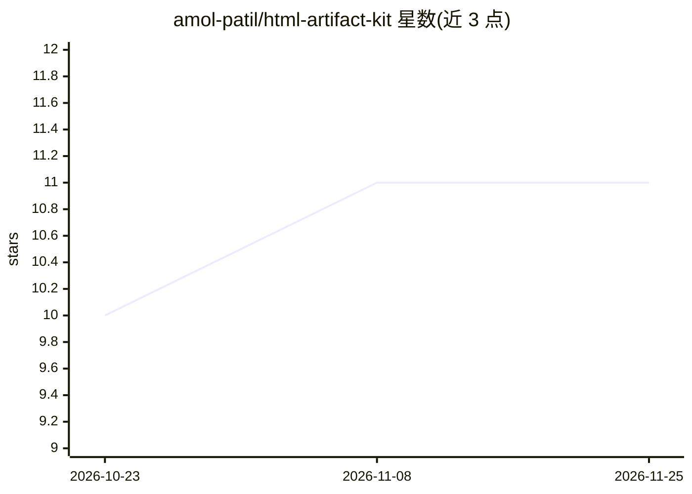

# amol-patil/html-artifact-kit

⭐ 11 · HTML · MIT · 推送 2026-08-22 · [GitHub](https://github.com/amol-patil/html-artifact-kit) · 个人维护

**给 AI agent 用的可移植 HTML 设计系统与 Agent Skill**

提供一套模型无关、agent 无关的设计系统，以 Agent Skill 形式安装在 Codex、Claude Code、Gemini CLI、Cursor 等 7 类 harness 中；技能注入统一的视觉基础、CSS、组件结构与可移植性契约，使 agent 生成自包含的单文件 HTML dashboard、报告、演示与操作工具。附带基于 Node 的合规审计脚本，产物需达到 85/100 且无关键失败；MIT 许可，脚本无需模型 API 或网络访问。

## 筛选速览

| 维度 | 判定 | 备注 |
|---|---|---|
| AI 角色 | `ai-ecosystem` | LLM/agent 周边工具 |
| 许可风险 | `permissive` | MIT |
| 部署形态 | `library` | 以包/库形式分发 |
| 模型依赖 | — | README 未给出锁定关系 |
| 硬件要求 | — | 无带数字的原话,不猜 |
| 安装摩擦 | `low` | 无编译、无系统依赖或容器化 |
| 成熟度 | — | 结构信号不足 |

## 能力要点

- npx 一条命令安装到全部支持的 harness（Codex/Claude Code/Gemini CLI/Cursor 等）
- 生成内嵌 CSS/JS、无生产 CDN 依赖的自包含 HTML 产物
- 确定性合规审计脚本与人工设计评分卡，最低门槛 85/100
- 桌面/平板/移动响应式与无障碍、打印行为契约

## 适用场景

- 让 agent 生成的仪表盘和报告保持一致的设计语言
- 交付可离线打开的单文件 HTML 演示与文档
- 批量校验 AI 生成页面是否达到设计合规分数

## 场景标签

`代码生成` · 领域:编码与开发

## 证据(README 行号)

> L18: Install one canonical skill for every supported harness:
> L128: The canonical skill is provider-neutral. Harness adapters only handle discovery; they do not change the design ins
> L157: Agent Skills can contain instructions and executable scripts. Review third-party skills before installing them. Th

## 星数曲线

2026-10-23 10 → 2026-11-25 11（+1）

---
*卡片 v1 · prompt 1.4 · 生成 2026-11-18 · 置信度 high · 依据 README sha `acaa776fb920` · [字段定义](../../DATASET.md)*
