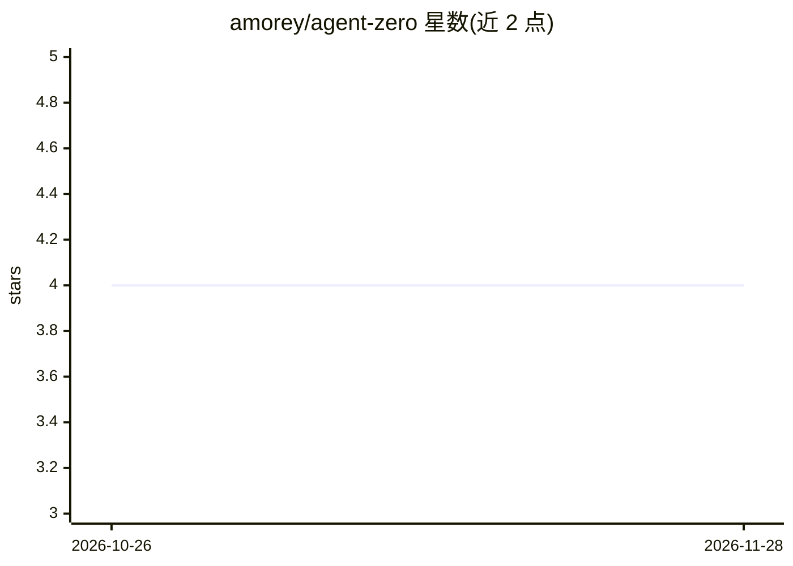

# amorey/agent-zero

⭐ 4 · Shell · MIT · 推送 2026-10-21 · [GitHub](https://github.com/amorey/agent-zero) · 个人维护

**AI 原生编程项目的起步模板：规范 agent 行为与产出**

一个极简的 GitHub 模板仓库，用于启动新的编程项目。通过 CLAUDE.md/AGENTS.md 给编码 agent 提供写作标准与提交/PR/Issue 约定，SETUP.md 引导 agent 完成项目初始化后自删，附带 hook 脚本在每次提示时重申写作标准、sbx 沙箱环境脚本隔离 Linux 构建产物，并提供 ADR 目录与 PR/Issue 模板。作者称搭配 Opus/Fable 类 agent 效果好，Sonnet 类需更多人工监督。

## 筛选速览

| 维度 | 判定 | 备注 |
|---|---|---|
| AI 角色 | `ai-ecosystem` | LLM/agent 周边工具 |
| 许可风险 | `permissive` | MIT |
| 部署形态 | `None` |  |
| 模型依赖 | — | README 未给出锁定关系 |
| 硬件要求 | — | 无带数字的原话,不猜 |
| 安装摩擦 | `low` | 无编译、无系统依赖或容器化 |
| 成熟度 | — | 结构信号不足 |

## 能力要点

- CLAUDE.md/AGENTS.md 集中定义编码 agent 的写作与协作规范
- SETUP.md 由 agent 执行，完成模板配置后自动删除
- hook 脚本每次提示重申写作标准（约 100 tokens，依赖 jq）
- sbx 沙箱脚本避免构建产物与宿主机冲突

## 适用场景

- 启动一个由 Claude Code/Codex 等 agent 参与开发的新项目
- 为团队统一 agent 的提交、PR 和 Issue 规范
- 在沙箱环境中让 agent 安全执行构建任务

## 场景标签

 · 领域:开发工具/工程效率

## 证据(README 行号)

> L3: *A starter template for AI-native coding projects*
> L9: **Agent-Zero** is a minimal, *slightly* opinionated GitHub template that you can use when you're starting a new codi

## 星数曲线

2026-10-26 4 → 2026-11-28 4（+0）

---
*卡片 v1 · prompt 1.4 · 生成 2026-11-21 · 置信度 high · 依据 README sha `58a4ca12940c` · [字段定义](../../DATASET.md)*
