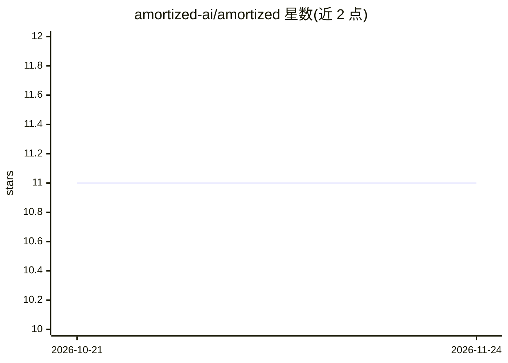

# amortized-ai/amortized

⭐ 11 · Python · Apache-2.0 · 推送 2026-11-23 · [GitHub](https://github.com/amortized-ai/amortized) · 组织维护

**为 agent 任务微调小型模型的编排平台**

Amortized 是一个微调任务模型的编排工具：用户描述任务后，系统从教师模型生成合成训练数据，微调小型学生模型，并评估学生是否达到教师水平。架构为薄编排层，将用户意图转为工具原生 YAML 配置，派发 Kubernetes Job 并跟踪生命周期；工件/血统交给 MLflow，存储交给 S3，训练与推理逻辑交给 TRL/asynth/vLLM。后端 FastAPI + 前端 React，提供本地与 kustomize 部署方式。

## 筛选速览

| 维度 | 判定 | 备注 |
|---|---|---|
| AI 角色 | `ai-ecosystem` | LLM/agent 周边工具 |
| 许可风险 | `permissive` | Apache-2.0 |
| 部署形态 | `library` | 以包/库形式分发 |
| 模型依赖 | — | README 未给出锁定关系 |
| 硬件要求 | — | 无带数字的原话,不猜 |
| 安装摩擦 | `low` | 无编译、无系统依赖或容器化 |
| 成熟度 | — | 结构信号不足 |

## 能力要点

- 从教师模型生成合成数据并微调小型学生模型
- 训练（TRL/training-hub）与 SDG（Data Designer）两类 K8s Job
- 环境变量前缀 AMORTIZED_ 统一配置，支持 local/ssh/kubernetes 计算后端
- 提供 kustomize 开发版与 OpenShift/ROSA 部署清单

## 适用场景

- 把 agent 流水线中的分类/抽取/路由任务换成自托管小模型
- 在自有基础设施上批量构建与评估任务模型
- 用合成数据流水线替代人工标注训练集

## 场景标签

`微调` `MLOps` · 领域:训练与推理

## 证据(README 行号)

> L7: **Amortized builds these task models.** You describe the task, it generates training data from a teacher model, fine
> L110: Amortized is a thin orchestration layer. It translates user intent into tool-native YAML configs, dispatches K8s J

## 星数曲线

2026-10-21 11 → 2026-11-24 11（+0）

---
*卡片 v1 · prompt 1.4 · 生成 2026-11-18 · 置信度 high · 依据 README sha `87a1fdb37e36` · [字段定义](../../DATASET.md)*
