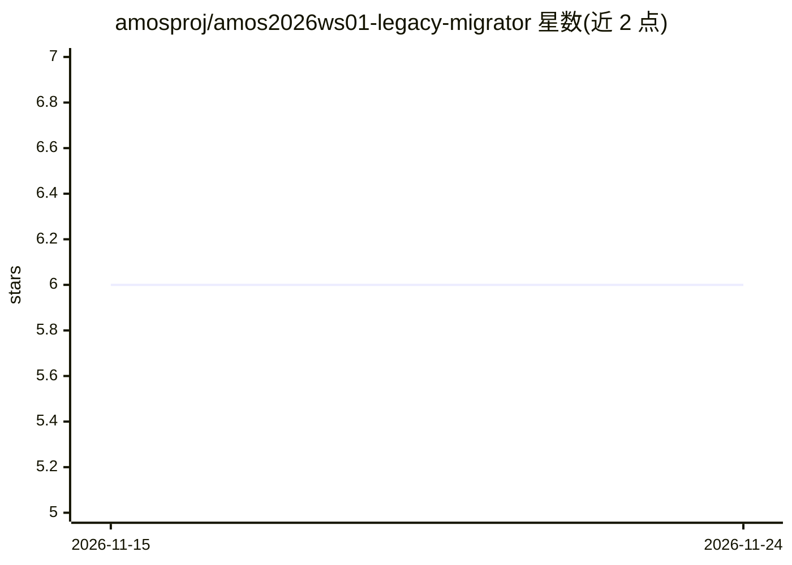

# amosproj/amos2026ws01-legacy-migrator

⭐ 6 · Python · MIT · 推送 2026-11-22 · [GitHub](https://github.com/amosproj/amos2026ws01-legacy-migrator) · 组织维护

**面向软件团队的遗留系统迁移知识库原型，自然语言查询**

SunsetTracker 是一个原型工具，为软件团队迁移遗留系统提供支持：构建包含遗留代码、目标代码、领域知识与系统依赖的知识库，支持自然语言查询，并可视化为 arc42 视图。实现为 FastAPI 后端加 React 前端，用户在浏览器提问后收到流式 LLM 回答；提供一键启动脚本与 Docker Compose 部署，另含知识摄入流水线。目前为原型阶段的垂直切片（来自 #24/25/27/28 工单）。

## 筛选速览

| 维度 | 判定 | 备注 |
|---|---|---|
| AI 角色 | `ai-native` | 本体是模型或模型工具 |
| 许可风险 | `permissive` | MIT |
| 部署形态 | `self-host` | docker 或自建部署 |
| 模型依赖 | — | README 未给出锁定关系 |
| 硬件要求 | — | 无带数字的原话,不猜 |
| 安装摩擦 | `low` | 无编译、无系统依赖或容器化 |
| 成熟度 | — | 结构信号不足 |

## 能力要点

- 自然语言查询遗留系统迁移知识库
- LLM 流式回答，浏览器端交互
- 可视化输出 arc42 架构视图
- Docker Compose 一键部署

## 适用场景

- 向系统提问迁移相关问题并查看架构视图
- 将遗留代码与领域知识汇入知识库辅助迁移

## 场景标签

`知识图谱` · 领域:知识与检索

## 证据(README 行号)

> L9: Vertical slice from tickets #24, #25, #27, #28: ask a migration question in the
> L10: browser and receive a streamed LLM answer.

## 星数曲线

2026-11-15 6 → 2026-11-24 6（+0）

---
*卡片 v1 · prompt 1.4 · 生成 2026-11-20 · 置信度 mid · 依据 README sha `da5565926b7b` · [字段定义](../../DATASET.md)*
