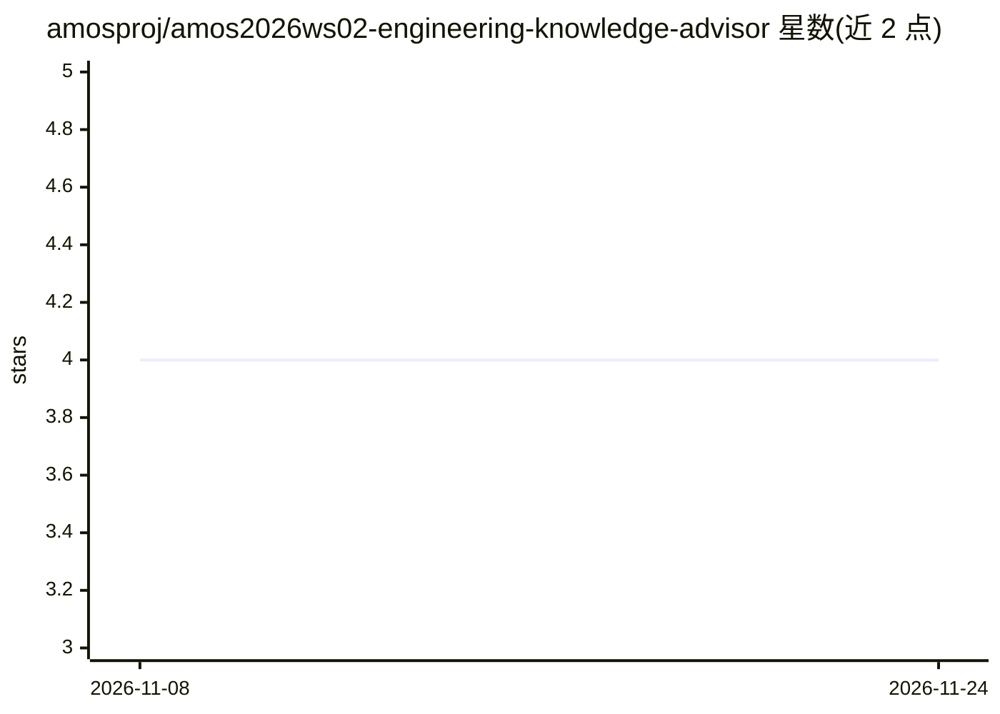

# amosproj/amos2026ws02-engineering-knowledge-advisor

⭐ 4 · Python · MIT · 推送 2026-11-23 · [GitHub](https://github.com/amosproj/amos2026ws02-engineering-knowledge-advisor) · 组织维护

**面向工程师的工程知识组织与 AI 检索原型**

开源原型应用，用于组织和访问工程知识，将知识条目关联到 CAD 装配组，并在新设计时用 AI 检索相关内容。架构为容器化 Web 应用：React/TypeScript 前端、FastAPI 后端、PostgreSQL（pgvector/pg_trgm）、MinIO 对象存储，由 Docker Compose 编排；后端用 cadquery-ocp 解析 STEP 文件提取结构。运行需 uv 与 Docker 前置条件，支持无 Docker 的本地开发模式（Node.js/npm 跑前端、uvicorn 跑 API），并带 SBOM 生成、pre-commit 钩子与 VPS 自动部署流程。

## 筛选速览

| 维度 | 判定 | 备注 |
|---|---|---|
| AI 角色 | `ai-native` | 本体是模型或模型工具 |
| 许可风险 | `permissive` | MIT |
| 部署形态 | `self-host` | docker 或自建部署 |
| 模型依赖 | — | README 未给出锁定关系 |
| 硬件要求 | — | 无带数字的原话,不猜 |
| 安装摩擦 | `low` | 无编译、无系统依赖或容器化 |
| 成熟度 | — | 结构信号不足 |

## 能力要点

- 知识关联 CAD 装配组并用 AI 检索（项目使命）
- pgvector/pg_trgm 作为向量相似度检索基础
- cadquery-ocp 解析 STEP 文件并提取结构
- Docker Compose 一键编排前端、API、数据库与存储

## 适用场景

- 在工程文档与知识源中检索相关设计资料
- 将既有产品知识沉淀并关联到 CAD 装配组
- 本地一致性环境下运行完整的知识库应用栈

## 场景标签

`RAG` `知识库管理` `文档解析` · 领域:知识与检索

## 证据(README 行号)

> L3: An application for organizing and accessing engineering knowledge, with the goal of helping users find relevant info
> L11: Deliver an open-source prototype that lets Bosch engineers capture knowledge about existing products, linked to the
> L208: |Vector search|pgvector|Foundation for vector similarity search|

## 星数曲线

2026-11-08 4 → 2026-11-24 4（+0）

---
*卡片 v1 · prompt 1.4 · 生成 2026-11-21 · 置信度 mid · 依据 README sha `7667f5e4d27f` · [字段定义](../../DATASET.md)*
