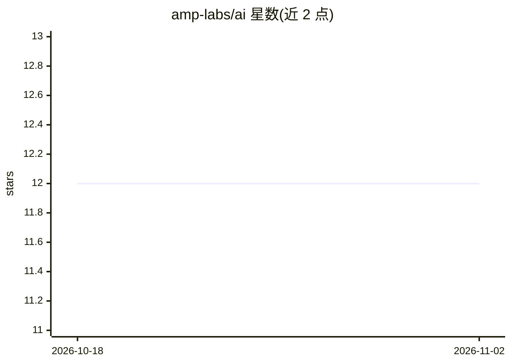

# amp-labs/ai

⭐ 12 · TypeScript · MIT · 推送 2026-05-30 · [GitHub](https://github.com/amp-labs/ai) · 组织维护

**Ampersand 官方 AI SDK 与 MCP 服务器：让 agent 操作客户 SaaS 集成**

Ampersand 官方仓库，含两部分：AI SDK 暴露供 AI agent 管理和调用客户 SaaS 工具集成的工具函数；MCP 服务器将同一批工具以多租户 MCP 形式提供，接入 Ampersand 平台的 150+ 连接器。SDK 模块兼容 Vercel AI SDK 与 Mastra 框架，通过 npm 安装；测试需 OpenAI API key 与 Ampersand 凭证。远程 MCP 支持 SSE 与 stdio 模式，需 Ampersand API key。

## 筛选速览

| 维度 | 判定 | 备注 |
|---|---|---|
| AI 角色 | `ai-ecosystem` | LLM/agent 周边工具 |
| 许可风险 | `permissive` | MIT |
| 部署形态 | `library` | 以包/库形式分发 |
| 模型依赖 | — | README 未给出锁定关系 |
| 硬件要求 | — | 无带数字的原话,不猜 |
| 安装摩擦 | `low` | 无编译、无系统依赖或容器化 |
| 成熟度 | — | 结构信号不足 |

## 能力要点

- SDK 暴露 createRecord/updateRecord 等工具供 agent 调用
- 多租户 MCP 服务器接入 150+ Ampersand 连接器
- 提供 Vercel AI SDK 与 Mastra 两种框架接入模块
- 支持 SSE 与 stdio 两种 MCP 连接模式

## 适用场景

- 给我的 AI agent 增加读写客户 SaaS 数据的能力
- 通过 Cursor/Claude Desktop 连接 Ampersand MCP 服务器
- 在 Mastra 工作流中调用 SaaS 集成工具

## 场景标签

`Agent 框架` · 领域:Agent 开发

## 证据(README 行号)

> L9: This repo contains the official Ampersand AI SDK and the offical MCP server for Ampersand.
> L11: - AI SDK - Official Ampersand AI SDK that exposes tools for your AI agents to manage and interact with integrations
> L16: Ampersand is a platform for AI builders to add B2B SaaS integrations to their agentic apps. To learn more, visit ou

## 星数曲线

2026-10-18 12 → 2026-11-02 12（+0）

---
*卡片 v1 · prompt 1.4 · 生成 2026-11-01 · 置信度 high · 依据 README sha `cb30de841119` · [字段定义](../../DATASET.md)*
