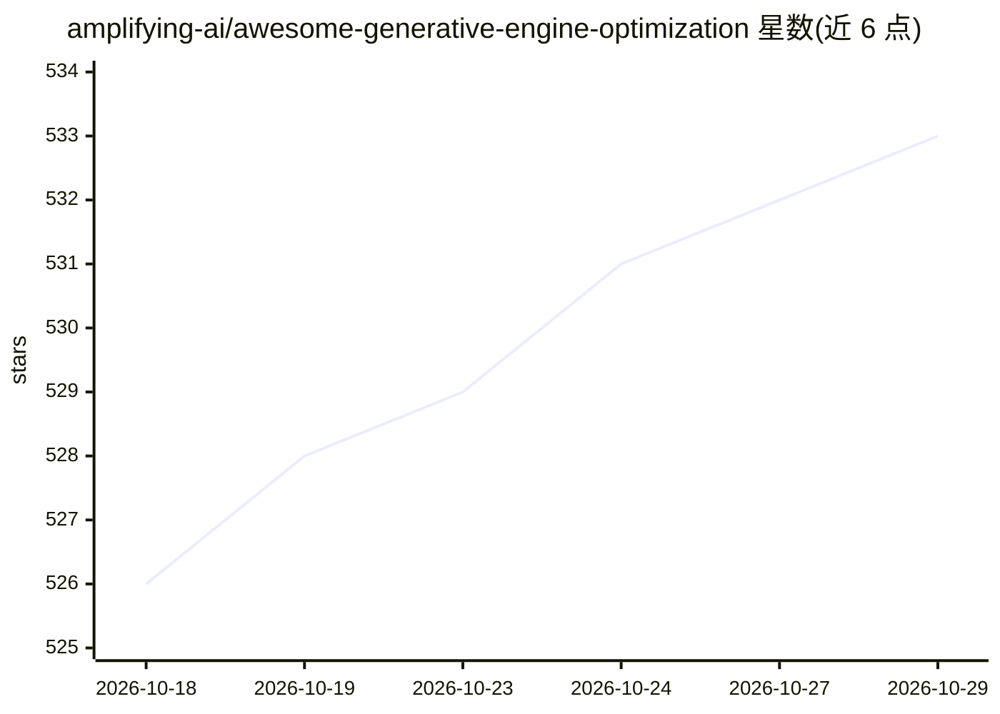

# amplifying-ai/awesome-generative-engine-optimization

⭐ 533 · 推送 2026-04-14 · [GitHub](https://github.com/amplifying-ai/awesome-generative-engine-optimization) · 组织维护

**生成式引擎优化（GEO）资源策展清单：指南、工具与研究**

面向内容营销与 SEO 从业者的 GEO 主题 awesome list：汇集入门与分平台（Google AI Overviews、ChatGPT Search、Perplexity）优化指南、案例研究、商业 GEO 平台与企业 SEO 工具名录、开源可见性追踪工具、llms.txt 生成器、学术论文（含对抗与安全研究）、AI 爬虫与结构化数据技术文档，以及 Google UCP 代理商务协议资料。本身为纯清单仓库（CC0 许可），不提供软件安装或运行。

## 筛选速览

| 维度 | 判定 | 备注 |
|---|---|---|
| AI 角色 | `ai-knowledge` | 知识聚合/清单类 |
| 许可风险 | `none` | — |
| 部署形态 | `None` |  |
| 模型依赖 | — | README 未给出锁定关系 |
| 硬件要求 | — | 无带数字的原话,不猜 |
| 安装摩擦 | `medium` | 含编译或系统依赖之一 |
| 成熟度 | — | 结构信号不足 |

## 能力要点

- 覆盖指南、工具平台、研究论文、技术文档四类资源
- 收录 GEO 基础研究（Princeton 等 40% 可见性提升研究）与 NeurIPS 2025 基准
- 含对抗性 SEO/提示注入等安全研究条目
- 追踪 llms.txt 协议规范与采用情况、Google UCP 代理商务协议

## 适用场景

- 学习如何让品牌内容在 AI 搜索引擎中获得引用
- 选型 GEO/AI 可见性监测平台或 llms.txt 生成工具
- 查阅 AI 搜索排名机制的学术与逆向工程研究

## 场景标签

`精选清单` · 领域:学习与行业

## 证据(README 行号)

> L1: # Awesome Generative Engine Optimization (GEO) Awesome License: CC0-1.0
> L3: > A curated list of resources for optimizing content visibility in AI-powered search engines (ChatGPT, Perplexity, G
> L9: ## Guides & Tutorials

## 星数曲线

2026-10-18 526 → 2026-10-29 533（+7）

---
*卡片 v1 · prompt 1.4 · 生成 2026-10-22 · 置信度 high · 依据 README sha `ae2c52ec7167` · [字段定义](../../DATASET.md)*
