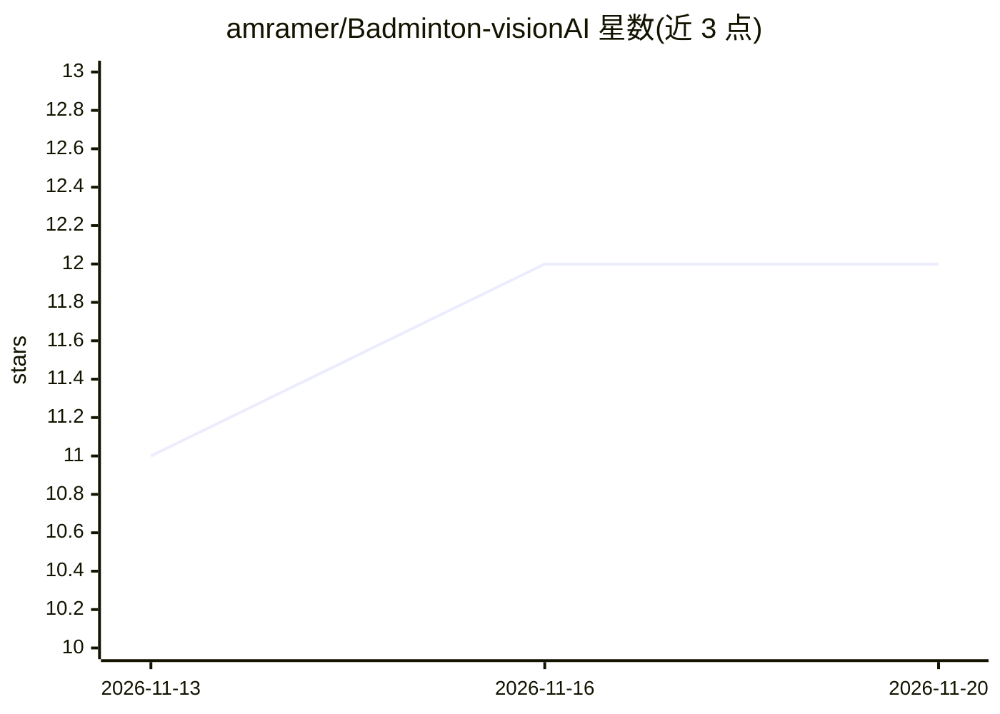

# amramer/Badminton-visionAI

⭐ 12 · Python · NOASSERTION · 推送 2026-04-05 · [GitHub](https://github.com/amramer/Badminton-visionAI) · 个人维护

**羽毛球比赛视频分析流水线：追踪、轨迹、击球分类与看板**

端到端计算机视觉流水线，将羽毛球比赛录像处理为带标注视频与 JSON 数据：YOLOv8m+ByteTrack 球员追踪、SAM 球员分割、TrackNet+InpaintNet 球拍轨迹恢复、ResNet 关键点+RANSAC 单应性球场映射，以及基于 Roboflow 托管模型的击球类型分类；Streamlit 看板读取流水线输出做热图、统计与 PDF 教练报告。分两个 Docker 容器（流水线与看板）运行，预训练权重需另行下载。源代码为专有受限许可，禁止再分发与商用。

## 筛选速览

| 维度 | 判定 | 备注 |
|---|---|---|
| AI 角色 | `ai-native` | 本体是模型或模型工具 |
| 许可风险 | `none` | NOASSERTION |
| 部署形态 | `self-host` | docker 或自建部署 |
| 模型依赖 | — | README 未给出锁定关系 |
| 硬件要求 | — | 无带数字的原话,不猜 |
| 安装摩擦 | `low` | 无编译、无系统依赖或容器化 |
| 成熟度 | — | 结构信号不足 |

## 能力要点

- 9 阶段流水线：球场检测、球员追踪、球轨迹、击球检测、可视化
- TrackNet+InpaintNet 轨迹重建，含遮挡帧插值
- Streamlit 交互看板：热图、击球画像、逐帧回放、可导出 PDF 教练报告
- 双 Dockerfile：CV 流水线与 Web 看板分离部署，支持 JSON 缓存跳过重算

## 适用场景

- 分析自己训练或比赛的录像，获取跑位热图与击球统计
- 为教练生成带战术建议的 PDF 表现报告
- 在标定球场视角下回放并逐帧查看追踪叠加结果

## 场景标签

`目标检测` · 领域:感知与多模态

## 证据(README 行号)

> L20: **Badminton-VisionAI** is an end-to-end AI pipeline that transforms raw match footage into actionable performance i
> L190: The pipeline executes 9 sequential stages — initialisation, config loading, video decoding, court detection, playe

## 星数曲线

2026-11-13 11 → 2026-11-20 12（+1）

---
*卡片 v1 · prompt 1.4 · 生成 2026-11-18 · 置信度 high · 依据 README sha `73404a6753b1` · [字段定义](../../DATASET.md)*
