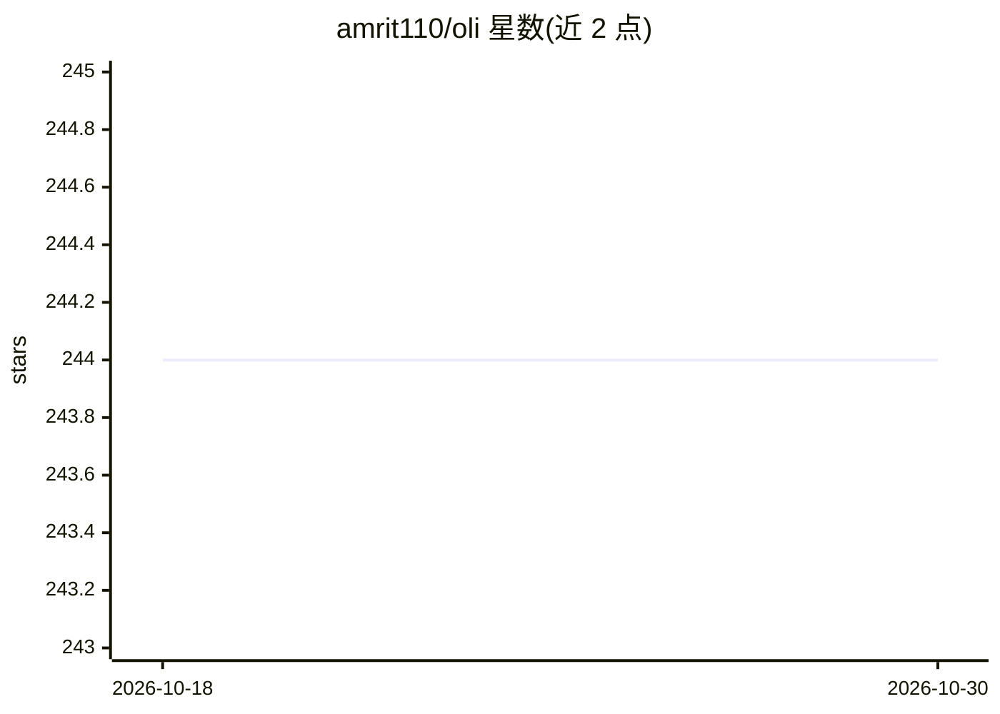

# amrit110/oli

⭐ 244 · Rust · Apache-2.0 · 推送 2026-06-29 · [GitHub](https://github.com/amrit110/oli) · [官网](https://amrit110.github.io/oli/) · 个人维护

**面向开发者的终端 AI 编程助手，支持云端与本地模型**

用 Rust 后端与 React/Ink 前端构成的混合架构终端 AI 编程助手，自称 Claude Code 的开源替代。支持 Anthropic Claude 3.7 Sonnet、OpenAI GPT-4o、Google Gemini 云端 API 以及经 Ollama 运行的本地模型，具备文件搜索、代码编辑、命令执行等代理能力，各模型提供商均支持工具调用。README 声明项目处于极早期、易有 bug。通过 git clone 源码构建安装，运行 ./run.sh 启动。

## 筛选速览

| 维度 | 判定 | 备注 |
|---|---|---|
| AI 角色 | `ai-native` | 本体是模型或模型工具 |
| 许可风险 | `permissive` | Apache-2.0 |
| 部署形态 | `library` | 以包/库形式分发 |
| 模型依赖 | local-ok | 支持本地模型 |
| 硬件要求 | — | 无带数字的原话,不猜 |
| 安装摩擦 | `low` | 无编译、无系统依赖或容器化 |
| 成熟度 | `idea` | |

## 能力要点

- Rust 后端 + React/Ink 前端的混合架构
- 支持 Anthropic/OpenAI/Google 云端 API 与 Ollama 本地模型
- 代理能力：文件搜索、编辑与命令执行
- 各提供商均支持工具调用（function calling）

## 适用场景

- 在终端里通过对话让 AI 搜索、编辑项目文件
- 用自然语言执行 shell 命令与解释代码
- 使用 Ollama 本地模型离线完成编程辅助

## 场景标签

`编码 Agent` · 领域:编码与开发

## 证据(README 行号)

> L11: oli is an open-source alternative to Claude Code with powerful agentic capabilities for coding assistance. Features
> L17: - Strong agentic capabilities including file search, edit, and command execution

## 星数曲线

2026-10-18 244 → 2026-10-30 244（+0）

---
*卡片 v1 · prompt 1.4 · 生成 2026-10-22 · 置信度 high · 依据 README sha `370aa579b08e` · [字段定义](../../DATASET.md)*
