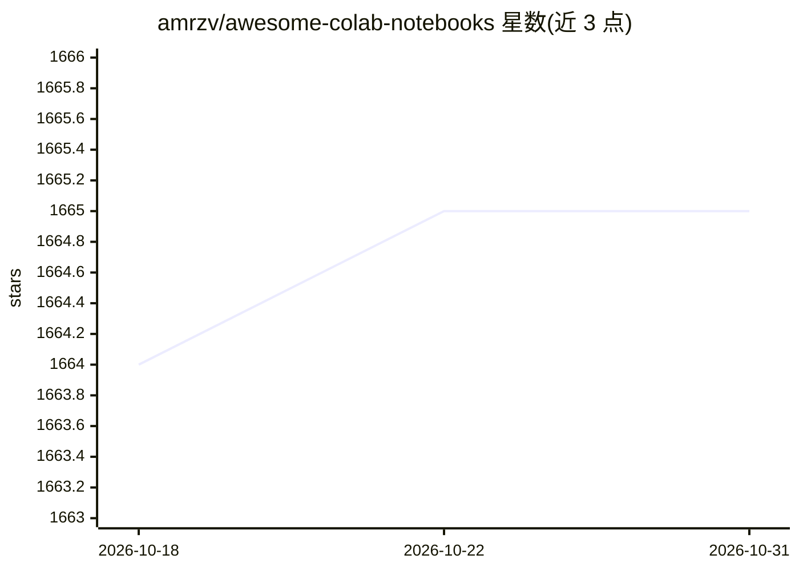

# amrzv/awesome-colab-notebooks

⭐ 1,665 · Python · MIT · 推送 2026-08-06 · [GitHub](https://github.com/amrzv/awesome-colab-notebooks) · 个人维护

**Google Colab 机器学习实验笔记本的策展清单（课程/项目）**

面向 ML 从业者与学习者的 Colab 笔记本聚合清单：按 Courses 与 Projects 两大板块组织条目，每个条目给出名称、简介、作者、外部链接（arXiv/GitHub/YouTube 等）以及 Open In Colab 的直接打开入口，并标注更新日期。内容覆盖强化学习、深度学习、时间序列、LLM、语音识别等课程，以及 Kornia、SHAP、YOLOv8、AlphaFold、NeMo 等项目。清单以 README 表格形式呈现，不提供自身代码或安装包。

## 筛选速览

| 维度 | 判定 | 备注 |
|---|---|---|
| AI 角色 | `ai-knowledge` | 知识聚合/清单类 |
| 许可风险 | `permissive` | MIT |
| 部署形态 | `library` | 以包/库形式分发 |
| 模型依赖 | — | README 未给出锁定关系 |
| 硬件要求 | — | 无带数字的原话,不猜 |
| 安装摩擦 | `medium` | 含编译或系统依赖之一 |
| 成熟度 | — | 结构信号不足 |

## 能力要点

- Courses 与 Projects 双板块组织条目
- 每条目提供 Open In Colab 直达链接与更新日期
- 覆盖 RL、深度学习、LLM、语音、CV 等领域课程与项目

## 适用场景

- 找可直接在 Colab 上运行的课程配套笔记本
- 查找知名 ML 项目的 Colab 入口与相关资料
- 按更新时间了解可用的实验笔记本资源

## 场景标签

`精选清单` · 领域:学习与行业

## 证据(README 行号)

> L7: # Awesome colab notebooks collection for ML experiments
> L16: |name|description|authors|links|colaboratory|update|

## 星数曲线

2026-10-18 1,664 → 2026-10-31 1,665（+1）

---
*卡片 v1 · prompt 1.4 · 生成 2026-10-21 · 置信度 mid · 依据 README sha `be5e96637efc` · [字段定义](../../DATASET.md)*
