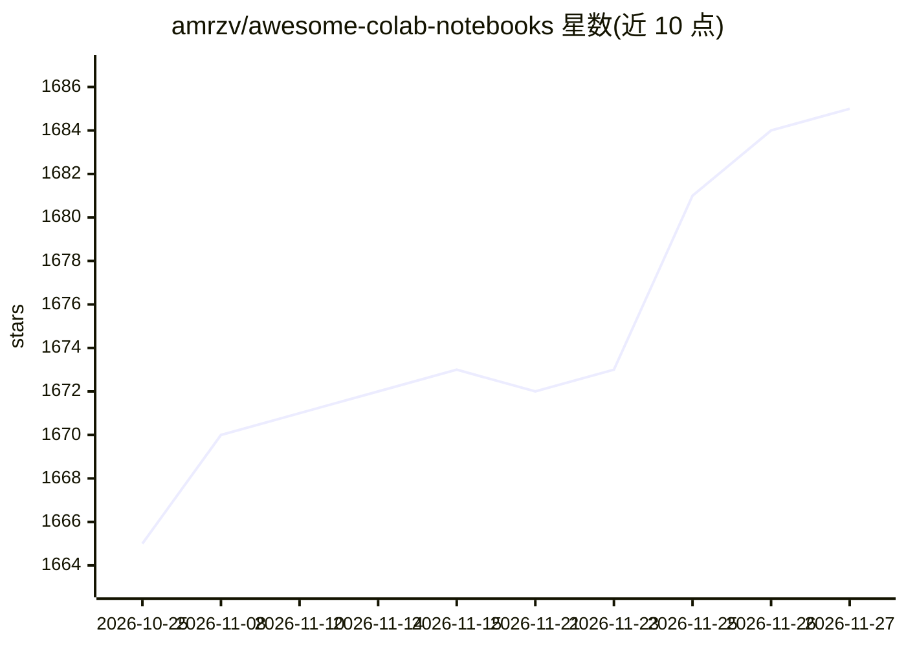

# amrzv/awesome-colab-notebooks

⭐ 1,685 · Python · MIT · 推送 2026-11-15 · [GitHub](https://github.com/amrzv/awesome-colab-notebooks) · 个人维护

**面向 ML 学习者的 Google Colab 笔记本清单，一键打开即跑**

一个聚合 Colab 笔记本条目的策展清单：按 Courses（数十门机器学习/深度学习/强化学习课程，每门附 Open In Colab 直达链接与更新日期）和 Projects（Litellm、YOLOv8、BERT 微调、Transformer 教程等项目条目）两类组织，另设 Trending 板块列出趋势仓库、论文与包。条目附作者、外部资源（arxiv/git/视频）链接。内容仅由 README 表格构成，不包含本产品自身的安装或运行说明。

## 筛选速览

| 维度 | 判定 | 备注 |
|---|---|---|
| AI 角色 | `ai-knowledge` | 知识聚合/清单类 |
| 许可风险 | `permissive` | MIT |
| 部署形态 | `library` | 以包/库形式分发 |
| 模型依赖 | — | README 未给出锁定关系 |
| 硬件要求 | — | 无带数字的原话,不猜 |
| 安装摩擦 | `medium` | 含编译或系统依赖之一 |
| 成熟度 | — | 结构信号不足 |

## 能力要点

- 数十门 ML/DL/RL 课程条目均附 Open In Colab 直达入口
- 按 Courses / Projects / Trending 三类组织条目
- 每条目注明作者、外部资源链接与最近更新日期
- Trending 板块追踪趋势仓库、论文与包三类列表

## 适用场景

- 在 Colab 上找一门深度学习入门课程跟着练
- 为某个项目（如 YOLOv8、BERT 微调）寻找可直接运行的示例笔记本
- 浏览当前机器学习领域的热门仓库与论文

## 场景标签

`教程课程` `精选清单` · 领域:学习与行业

## 证据(README 行号)

> L7: # Awesome colab notebooks collection for ML experiments
> L12: ## Courses
> L48: ## Projects

## 星数曲线

2026-10-25 1,665 → 2026-11-27 1,685（+20）

---
*卡片 v1 · prompt 1.4 · 生成 2026-11-23 · 置信度 mid · 依据 README sha `f578cbd26032` · [字段定义](../../DATASET.md)*
