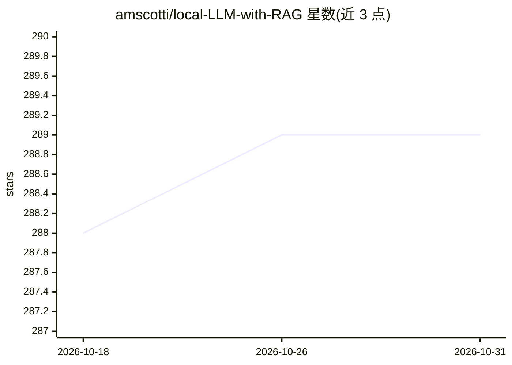

# amscotti/local-LLM-with-RAG

⭐ 289 · Python · MIT · 推送 2026-07-11 · [GitHub](https://github.com/amscotti/local-LLM-with-RAG) · 个人维护

**本地 LLM 驱动的 agentic RAG 文档问答应用**

基于 Pydantic AI 与 Ollama 的实验性沙盒项目：通过 Streamlit Web UI 选择模型、指定文档文件夹并与之对话。采用 agentic 方式而非固定 RAG 流水线，由模型自行决定是否及如何检索文档，要求所选 LLM 支持 tool calling。使用 Ollama 生成 nomic-embed-text 嵌入并存入 LanceDB 做向量检索，文档加载支持 PDF/Office/Markdown/HTML/CSV/JSON。README 给出了基准测试的推荐模型（qwen3.5:9b 等）与 4 次搜索上限等防护措施。

## 筛选速览

| 维度 | 判定 | 备注 |
|---|---|---|
| AI 角色 | `ai-native` | 本体是模型或模型工具 |
| 许可风险 | `permissive` | MIT |
| 部署形态 | `None` |  |
| 模型依赖 | local-ok | 支持本地模型 |
| 硬件要求 | — | 无带数字的原话,不猜 |
| 安装摩擦 | `low` | 无编译、无系统依赖或容器化 |
| 成熟度 | `idea` | |

## 能力要点

- agentic 检索：由模型自主决定何时及如何搜索文档
- LanceDB 向量检索 + nomic-embed-text 嵌入（经 Ollama 生成）
- 支持 PDF/Word/PPT/Excel/Markdown/HTML/CSV/JSON 文档格式
- 附基准评测脚本（bench/）与推荐模型列表

## 适用场景

- 在本地对私有文档做问答而不依赖云端 API
- 实验 agentic RAG 与固定 RAG 流水线的差异
- 测试不同本地模型在工具调用型 RAG 任务上的表现

## 场景标签

`文档问答` `RAG` · 领域:知识与检索

## 证据(README 行号)

> L5: This project is an experimental sandbox for testing out ideas related to running local Large Language Models (LLMs) 
> L33: **Important:** The selected LLM must support **tool calling** (function calling). The application uses an agentic a

## 星数曲线

2026-10-18 288 → 2026-10-31 289（+1）

---
*卡片 v1 · prompt 1.4 · 生成 2026-10-22 · 置信度 high · 依据 README sha `22b9483e27cd` · [字段定义](../../DATASET.md)*
