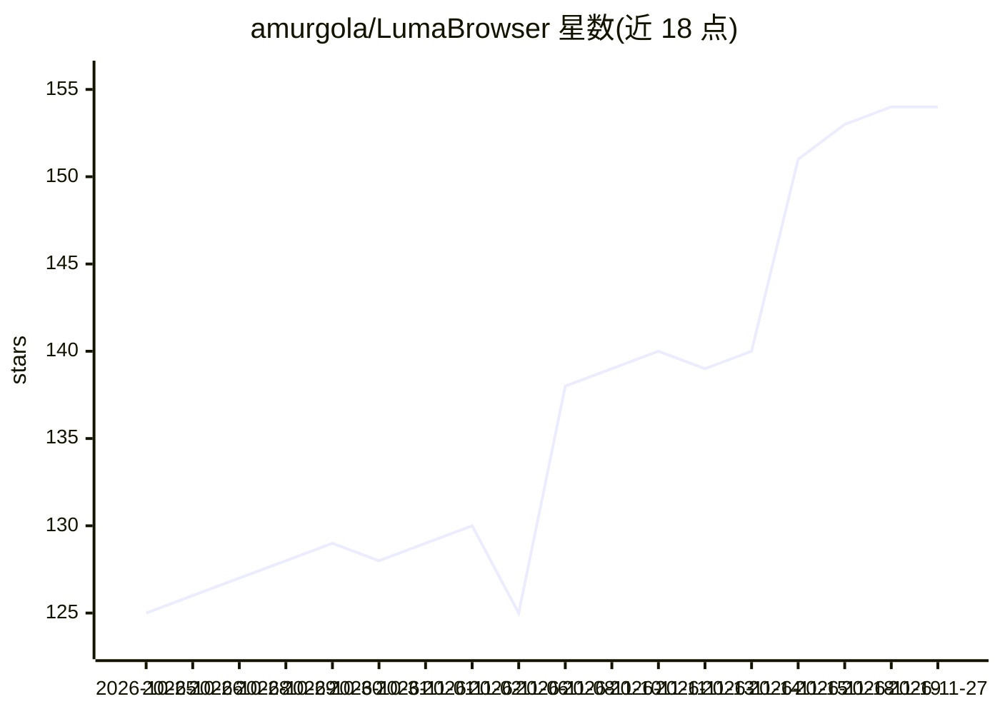

# amurgola/LumaBrowser

⭐ 154 · JavaScript · NOASSERTION · 推送 2026-11-26 · [GitHub](https://github.com/amurgola/LumaBrowser) · [官网](https://lumabyte.com) · 组织维护

**本地 AI 桌面应用：内置模型运行时的 Chromium 浏览器**

将模型服务器、聊天界面、图像/视频/音乐生成、语音栈和浏览器自动化整合为一个桌面应用，共享本机 GPU 与模型。核心机制包括：读取硬件后为每个模型给出适配标记与预测速度、llama.cpp 与 MLX 运行时支持多 GPU/多机拆分与 drafter 加速、通过 MCP/ACP/WebDriver/CDP 让外部编码代理驱动真实浏览器标签页、在 127.0.0.1:8317 暴露 OpenAI 与 Anthropic 兼容 API。提供 Windows/macOS/Linux 安装包，容器内无 GPU 加速，REST API 与自动化端口默认关闭。

## 筛选速览

| 维度 | 判定 | 备注 |
|---|---|---|
| AI 角色 | `ai-native` | 本体是模型或模型工具 |
| 许可风险 | `none` | NOASSERTION |
| 部署形态 | `desktop` | 安装包/桌面程序 |
| 模型依赖 | local-ok | 支持本地模型 |
| 硬件要求 | — | 无带数字的原话,不猜 |
| 安装摩擦 | `low` | 无编译、无系统依赖或容器化 |
| 成熟度 | — | 结构信号不足 |

## 能力要点

- 模型下载前按本机 GPU 给出适配标记与预测速度，已有 LM Studio/Ollama/HF 缓存模型可免重复下载
- llama.cpp 与 MLX 运行时覆盖 NVIDIA/AMD/Intel/Qualcomm/Apple，支持多卡拆分与 drafter 加速
- MCP 服务器将已登录的真实浏览器交给 Claude Code/Codex/Cline 等代理
- 集成 FLUX、Qwen-Image、Wan 2.2 等图像/视频/音乐生成与语音克隆

## 适用场景

- 在不把数据发到云端的前提下本地运行 LLM 聊天与图像生成
- 让编码代理在我已登录的浏览器标签页中完成网页操作
- 在低配笔记本上先确认模型能否跑得动再下载
- 用 Docker 把整套应用无头部署到服务器供代理调用

## 场景标签

`浏览器自动化` `图像生成` `语音合成` `推理引擎` · 领域:效率与自动化

## 证据(README 行号)

> L3:  Your local AI stack in one app.
> L46: |A headless browser for agents|Your real browser, with your logins, over MCP, ACP, WebDriver and CDP|
> L71: |**Browser** A Chromium browser with an ad blocker, Chrome extensions, a password manager, private windows, and a S

## 星数曲线

2026-10-25 125 → 2026-11-27 154（+29）

---
*卡片 v1 · prompt 1.4 · 生成 2026-11-27 · 置信度 high · 依据 README sha `48274cf3f297` · [字段定义](../../DATASET.md)*
