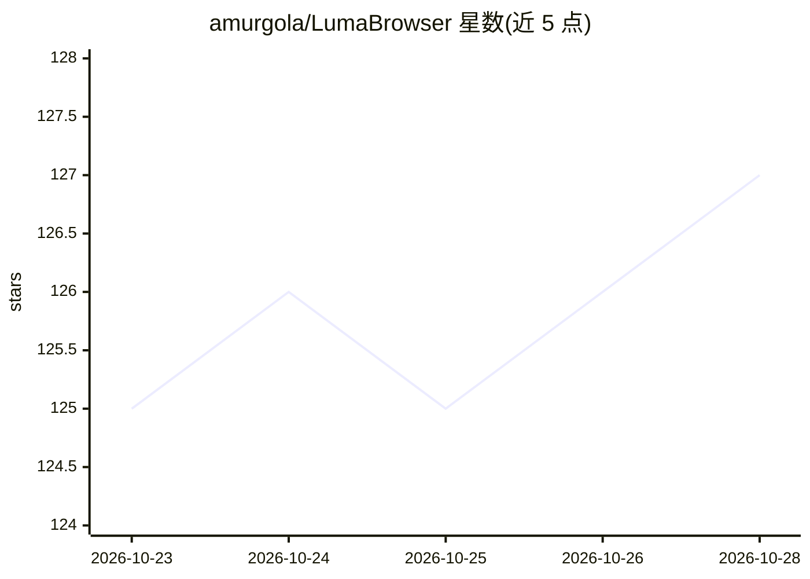

# amurgola/LumaBrowser

⭐ 127 · JavaScript · NOASSERTION · 推送 2026-10-24 · [GitHub](https://github.com/amurgola/LumaBrowser) · [官网](https://lumabyte.com) · 个人维护

**集成 LLM 运行时与 AI 工具链的本地 Chromium 浏览器桌面应用**

基于 Electron/Chromium 的桌面应用，内置 GPU 感知的 llama.cpp 运行时（CPU/CUDA/Vulkan/MLX），支持本地 LLM 对话与 agent、图像/视频/音乐生成、语音识别与合成，并检测硬件为模型标注适配度与预测速度。提供 OpenAI/Anthropic 兼容本地 API、MCP 服务器（供 Claude Code、Codex、Cline 等驱动浏览器）、WebDriver/CDP 自动化接口与 Docker 无头部署。也可接入 LM Studio、Ollama、vLLM 等外部端点。面向在单机运行本地 AI 工具链的用户。

## 筛选速览

| 维度 | 判定 | 备注 |
|---|---|---|
| AI 角色 | `ai-native` | 本体是模型或模型工具 |
| 许可风险 | `none` | NOASSERTION |
| 部署形态 | `desktop` | 安装包/桌面程序 |
| 模型依赖 | local-ok | 支持本地模型 |
| 硬件要求 | — | 无带数字的原话,不猜 |
| 安装摩擦 | `low` | 无编译、无系统依赖或容器化 |
| 成熟度 | — | 结构信号不足 |

## 能力要点

- 内置 llama.cpp 多后端运行时（CPU/CUDA 12/13/Vulkan/MLX），按显存为模型标注适配度
- MCP 服务器供 Claude Code、Codex、Cline、OpenCode 驱动浏览器
- 本地图像/视频/音乐生成与 STT/TTS（FLUX、Wan、Kokoro、whisper.cpp 等）
- 可选 OpenAI 与 Anthropic 兼容本地 API（127.0.0.1:8317）

## 适用场景

- 在一个桌面应用里运行本地模型对话、图像生成与语音，替代多个独立工具
- 让 Claude Code/Codex/Cline 等编码 agent 通过 MCP 操作真实浏览器
- 通过 Selenium/Puppeteer/Playwright 做浏览器自动化
- 用 Docker 在服务器上无头运行并远程访问

## 场景标签

`推理引擎` `浏览器自动化` `图像生成` · 领域:效率与自动化

## 证据(README 行号)

> L6:  A web browser with a GPU-aware LLM runtime, chat and agents, local image,
> L21: for agents) with one desktop app. It looks at your GPUs, tells you which models
> L90: - Optional local API that speaks both the OpenAI and Anthropic formats on

## 星数曲线

2026-10-23 125 → 2026-10-28 127（+2）

---
*卡片 v1 · prompt 1.4 · 生成 2026-10-23 · 置信度 high · 依据 README sha `48574df5f57a` · [字段定义](../../DATASET.md)*
