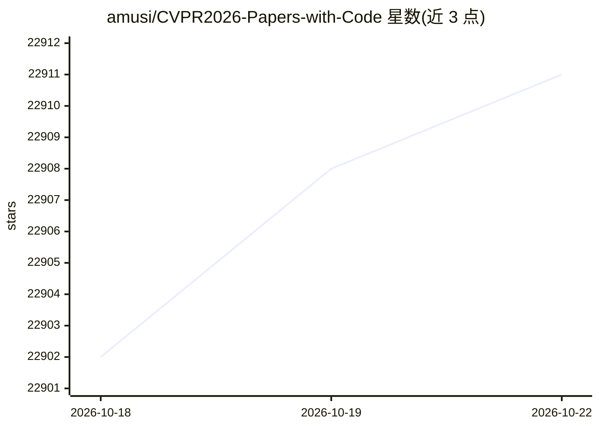

# amusi/CVPR2026-Papers-with-Code

⭐ 22,911 · 推送 2026-03-08 · [GitHub](https://github.com/amusi/CVPR2026-Papers-with-Code) · 个人维护 · 中文 README

**面向计算机视觉研究者的 CVPR 2026 论文与开源项目目录**

以 Markdown 目录形式持续收录 CVPR 2026 录用论文及其开源代码、项目页、模型链接，按 3DGS、Agent、多模态大语言模型、具身智能、自动驾驶、医学图像分割、3D 重建等数十个方向分类组织。条目附 arXiv 论文链接与 GitHub 代码仓库地址，部分含 Hugging Face 模型链接。读者可通过提交 issue 补充条目，README 同时导向维护者的往届 CV 论文盘点仓库与学术交流社群。

## 筛选速览

| 维度 | 判定 | 备注 |
|---|---|---|
| AI 角色 | `ai-knowledge` | 知识聚合/清单类 |
| 许可风险 | `none` | — |
| 部署形态 | `None` |  |
| 模型依赖 | — | README 未给出锁定关系 |
| 硬件要求 | — | 无带数字的原话,不猜 |
| 安装摩擦 | `low` | 无编译、无系统依赖或容器化 |
| 成熟度 | — | 结构信号不足 |

## 动量与使用信号

- 维护:`declining` — 距上次 push 224.0 天,年发版 0,4 位贡献者
- 涨星:近 1 天 **+2**(自 20261016 起算)
- 安装:github 包 `release-assets` 月下载无数据

## 能力要点

- 按数十个研究方向分类组织的 CVPR 2026 论文目录
- 每条条目附 arXiv 论文链接及代码/项目页/模型链接
- 欢迎通过 issue 提交新论文与开源项目
- 关联往届 ICCV/ECCV/CVPR 论文盘点仓库

## 适用场景

- 查找 CVPR 2026 某个研究方向（如 3D 重建、医学图像分割）的论文与代码
- 调研某篇论文是否已开源及其项目主页
- 跟踪计算机视觉领域的最新工作动向

## 场景标签

`精选清单` · 领域:学习与行业

## 证据(README 行号)

> L1: # CVPR 2026 论文和开源项目合集(Papers with Code)
> L14: # 【CVPR 2026 论文开源目录】

## 星数曲线

2026-10-18 22,902 → 2026-10-22 22,911（+9）

---
*卡片 v1 · prompt 1.4 · 生成 2026-10-18 · 置信度 high · 依据 README sha `65fdbe9e1bd1` · [字段定义](../../DATASET.md)*
