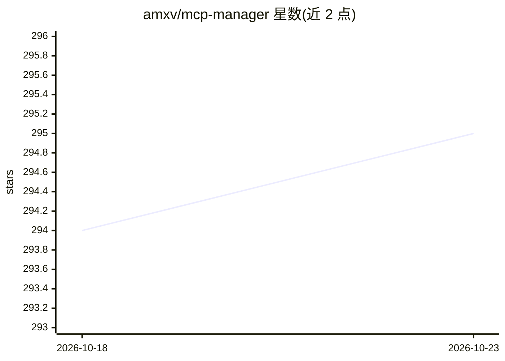

# amxv/mcp-manager

⭐ 295 · TypeScript · Apache-2.0 · 推送 2026-06-24 · [GitHub](https://github.com/amxv/mcp-manager) · [官网](https://mcp-manager.ashray.xyz) · 个人维护

**网页 GUI，管理 Claude Desktop 的 MCP 服务器配置**

面向 macOS Claude Desktop 用户的纯客户端 Web 界面：预置 Apple Notes、GitHub、Google Drive、Slack 等 20 余个流行 MCP 服务器的配置组件，用户填写环境变量后一键复制终端安装命令，写入 Claude 应用配置。数据不离开本机，无后端。技术栈为 React 18 + TypeScript + Vite + Bun，通过 Cloudflare Pages 部署。限制：仅针对 Claude Desktop 与 macOS 场景。

## 筛选速览

| 维度 | 判定 | 备注 |
|---|---|---|
| AI 角色 | `ai-ecosystem` | LLM/agent 周边工具 |
| 许可风险 | `permissive` | Apache-2.0 |
| 部署形态 | `None` |  |
| 模型依赖 | — | README 未给出锁定关系 |
| 硬件要求 | — | 无带数字的原话,不猜 |
| 安装摩擦 | `low` | 无编译、无系统依赖或容器化 |
| 成熟度 | — | 结构信号不足 |

## 能力要点

- 预置 20+ 流行 MCP 服务器的快速配置项
- 纯客户端运行，数据不上传
- 一键复制安装用的终端命令
- 支持环境变量与服务器设置配置

## 适用场景

- 给 Claude Desktop 添加文件系统、GitHub、Slack 等 MCP 服务器
- 不知道怎么写 MCP 配置时按界面引导生成安装命令
- 管理已有 MCP 服务器的环境变量设置

## 场景标签

 · 领域:LLM 工具/MCP 配置管理

## 证据(README 行号)

> L3:  A simple web GUI to manage Model Context Protocol (MCP) servers for the Claude Desktop app on MacOS easily. Just fo
> L16: - 🚀 Easy-to-use interface for managing MCP servers

## 星数曲线

2026-10-18 294 → 2026-10-23 295（+1）

---
*卡片 v1 · prompt 1.4 · 生成 2026-10-22 · 置信度 high · 依据 README sha `aa952586dfac` · [字段定义](../../DATASET.md)*
