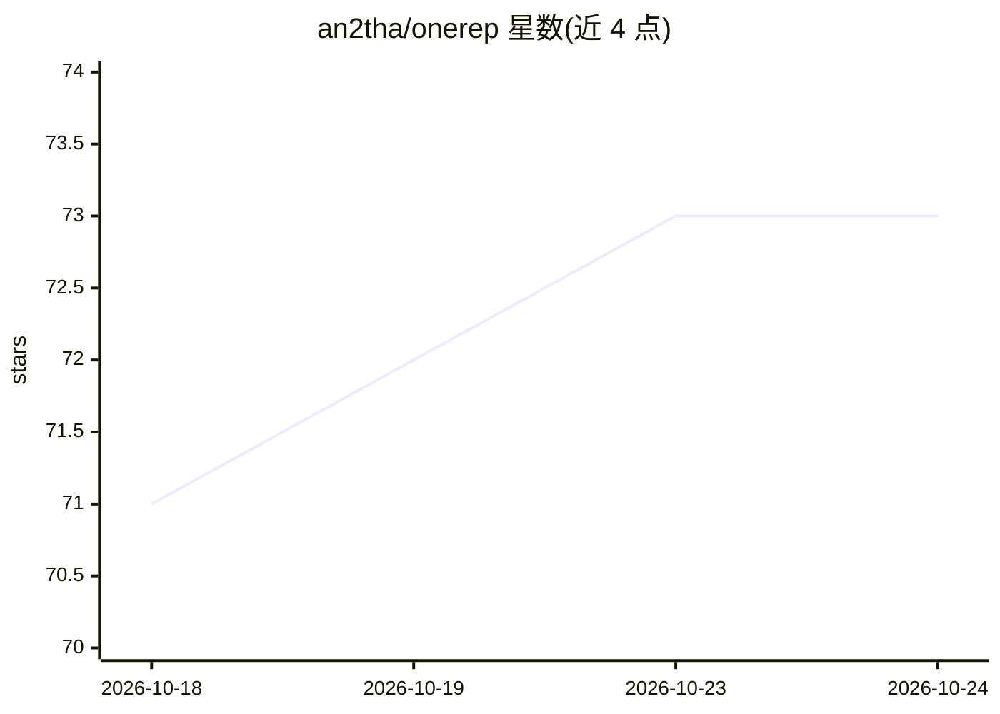

# an2tha/onerep

⭐ 74 · TypeScript · NOASSERTION · 推送 2026-10-24 · [GitHub](https://github.com/an2tha/onerep) · [官网](https://www.onerep.life) · 个人维护

**开源自托管健身追踪应用：饮食/训练/日记与 AI 教练一体**

面向个人用户的健身与健康记录应用，覆盖网页、PWA、iOS 与 Android（Capacitor 打包）。功能包括食物/水分/补剂记录、USDA 与 Open Food Facts 食物搜索及条码扫描、力量与耐力训练计划、GPS 路线记录、自定义追踪器与健康指标同步。AI 教练（Coach）可生成简报、餐食与训练调整建议，写入前需人工确认，支持自带 OpenRouter key。后端基于 Convex，提供 REST API 与 MCP 端点，可用 Docker Compose 与 Bun 自托管。许可证为 PolyForm Noncommercial（非商业）。

## 筛选速览

| 维度 | 判定 | 备注 |
|---|---|---|
| AI 角色 | `ai-enhanced` | 去掉 AI 部分产品仍成立 |
| 许可风险 | `none` | NOASSERTION |
| 部署形态 | `None` |  |
| 模型依赖 | — | README 未给出锁定关系 |
| 硬件要求 | — | 无带数字的原话,不猜 |
| 安装摩擦 | `low` | 无编译、无系统依赖或容器化 |
| 成熟度 | — | 结构信号不足 |

## 能力要点

- Snap & Log：从照片检测食物并人工确认后记录
- AI Coach 生成简报与训练/餐食建议，写入前需审核
- 支持 Apple Health / Health Connect 指标同步
- 自托管后端与食物数据源，提供 REST API 与 MCP 端点

## 适用场景

- 日常记录饮食、训练、水分与情绪并查看长期趋势
- 通过 AI 教练获取训练与营养建议并代为写入记录
- 在自己的服务器上托管健身数据与食物数据库

## 场景标签

 · 领域:健康与健身应用

## 证据(README 行号)

> L16: OneRep is an open-source personal fitness app for the web, PWA, iOS, and Android. It combines daily logging with lo
> L26: - **Coach:** Ask for briefings, meal and recipe help, or training changes. Review proposed writes before applying t

## 星数曲线

2026-10-18 71 → 2026-10-24 73（+2）

---
*卡片 v1 · prompt 1.4 · 生成 2026-10-24 · 置信度 high · 依据 README sha `f34b2568c914` · [字段定义](../../DATASET.md)*
