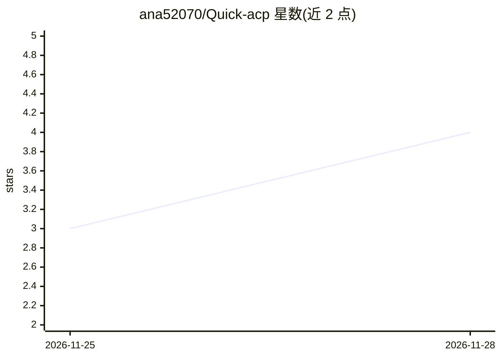

# ana52070/Quick-acp

⭐ 4 · TypeScript · MIT · 推送 2026-11-23 · [GitHub](https://github.com/ana52070/Quick-acp) · 个人维护 · 中文 README

**把 AWS Quick 的 Claude 配额桥接到任意 ACP 编辑器的本地代理**

本地执行的 ACP 代理，无需 Quick 官方桌面客户端，通过系统凭据或浏览器 OIDC 登录直连 Quick 网关，为 Codeg、T3 Code、Zed 等 ACP 客户端补充本地 Shell 执行、文件读写、图片转发、MCP 挂载、会话持久化与分叉恢复能力。以用户权限运行命令且非沙箱，提供环境变量关闭命令执行或逐次审批；单回合默认 12 次工具调用，超出返回 max_turn_requests。经 npx 免安装使用或源码编译。

## 筛选速览

| 维度 | 判定 | 备注 |
|---|---|---|
| AI 角色 | `ai-ecosystem` | LLM/agent 周边工具 |
| 许可风险 | `permissive` | MIT |
| 部署形态 | `desktop` | 安装包/桌面程序 |
| 模型依赖 | locked-api |  |
| 硬件要求 | — | 无带数字的原话,不猜 |
| 安装摩擦 | `low` | 无编译、无系统依赖或容器化 |
| 成熟度 | — | 结构信号不足 |

## 能力要点

- 通过 ACP 协议（JSON-RPC over stdio）接入任意标准 ACP 客户端
- 免桌面客户端：读取 Windows 凭据管理器/macOS Keychain 或浏览器 OIDC 登录
- 本机 Shell 执行与文件工具，带命令黑名单过滤、审批模式与关闭开关
- 会话级 MCP 挂载（stdio / Streamable HTTP / SSE）与本地持久化、分叉恢复

## 适用场景

- 让 Codeg/Zed 等 ACP 编辑器直接使用 AWS Quick 的 Claude 配额写代码
- 不装官方桌面端，用 SSO 浏览器登录后在终端环境直连网关
- 无人值守场景下通过环境变量限制权限并固定工具调用轮次

## 场景标签

`模型网关` `编码 Agent` · 领域:Agent 开发

## 证据(README 行号)

> L11: Quick-acp 是一个将 **AWS Quick (Quickwork)** 的 Claude 配额与推理能力，桥接到任何标准 **ACP (Agent Client Protocol)** 编辑器（如 **codeg**、*
> L21: **无需安装 Quick 官方桌面客户端**，通过系统已有凭据或独立的浏览器 OIDC 登录即可直连网关。
> L88: 支持任何标准 ACP 客户端。下面给出 Codeg、T3 Code、Zed 三种已验证或已知可用形态的配置，并为每种客户端附一段**可直接粘给 AI 助手执行的配置提示词**。

## 星数曲线

2026-11-25 3 → 2026-11-28 4（+1）

---
*卡片 v1 · prompt 1.4 · 生成 2026-11-25 · 置信度 mid · 依据 README sha `182e3b1762c5` · [字段定义](../../DATASET.md)*
