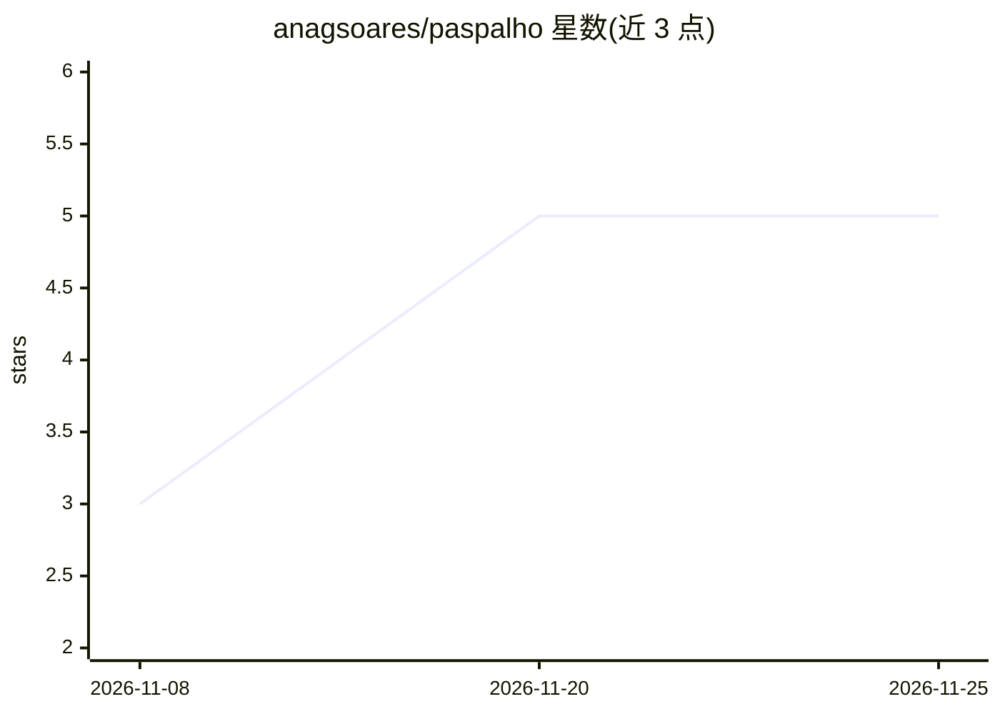

# anagsoares/paspalho

⭐ 5 · Python · MIT · 推送 2026-11-01 · [GitHub](https://github.com/anagsoares/paspalho) · [官网](https://instagram.com/ana.gsoares) · 个人维护 · 中文 README

**面向非程序员的 Claude Code 技能：调查社交媒体攻击性评论并生成视觉报告**

以 Claude Code skill 形式安装的社交媒体调查代理：通过本地表单发起调查，用独立 Chrome 配置文件以登录账号自动浏览 Instagram、Threads、X、LinkedIn、YouTube 等平台的公开内容，采集评论后按严重/嘲讽/正当批评三分类筛选，最多 3 轮深挖，最终输出包含'温度计'评分（分五档）、评论时间表、攻击模式与目标分析的 HTML+JSON 报告，保存到 Downloads/Paspalho。仅读取公开内容，不采集个人隐私信息；依赖 Chrome 与 Claude Code，仅支持 Mac/Windows（Windows 处于测试阶段）。

## 筛选速览

| 维度 | 判定 | 备注 |
|---|---|---|
| AI 角色 | `ai-native` | 本体是模型或模型工具 |
| 许可风险 | `permissive` | MIT |
| 部署形态 | `None` |  |
| 模型依赖 | — | README 未给出锁定关系 |
| 硬件要求 | — | 无带数字的原话,不猜 |
| 安装摩擦 | `low` | 无编译、无系统依赖或容器化 |
| 成熟度 | `idea` | |

## 能力要点

- 对采集评论做三分类筛选并按加权规则生成五档评分温度计
- 使用独立 Chrome 配置文件登录调查账号，登录保存后只需配置一次
- 报告中每条评论附原始链接，声明不编造或改写评论内容
- 全部数据保留在本地，无自有服务器

## 适用场景

- 检查某个社交账号是否长期发布攻击性评论
- 查找是否有人在社交平台辱骂或贬低自己
- 生成包含评论时间分布和攻击模式的可留档 HTML 报告

## 场景标签

`浏览器自动化` · 领域:效率与自动化

## 证据(README 行号)

> L3: Um **agente de investigação** que roda no **Claude Code**: ele vasculha as redes sociais atrás de comentários agress
> L16: No fim aparece o laudo: quantos comentários são graves e quantos são deboche, um termômetro que vai de "Gente boa" 
> L54: 4. **A triagem.** O Claude lê cada comentário e separa em três tipos:

## 星数曲线

2026-11-08 3 → 2026-11-25 5（+2）

---
*卡片 v1 · prompt 1.4 · 生成 2026-11-21 · 置信度 high · 依据 README sha `9b19cb211f2f` · [字段定义](../../DATASET.md)*
