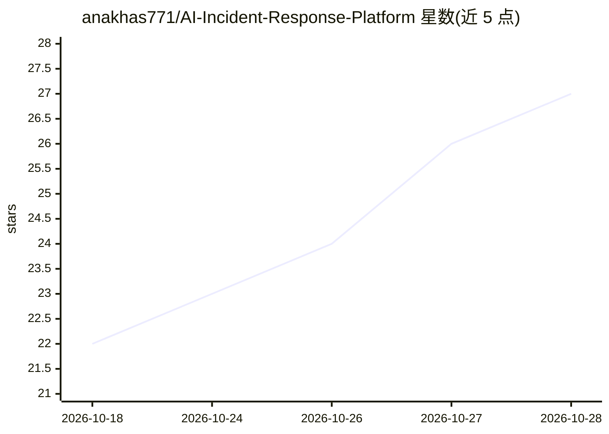

# anakhas771/AI-Incident-Response-Platform

⭐ 28 · TypeScript · NOASSERTION · 推送 2026-08-25 · [GitHub](https://github.com/anakhas771/AI-Incident-Response-Platform) · 个人维护

**面向工程团队的 AI 事件响应平台：RAG 分析生产事故**

面向 SRE/工程团队的事件响应平台：管理事件全生命周期（创建、分派、状态跟踪、审计），结合 RAG、语义搜索与向量检索（FAISS/OpenSearch、Sentence Transformers）对事件做 AI 摘要、根因分析、影响评估与修复建议，并提供自然语言 AI Copilot、知识库文档上传与索引、仪表盘与报表。技术栈为 Django REST Framework + React + PostgreSQL/Redis/Celery，通过 Docker Compose 部署；LLM 支持 OpenAI 与 Ollama。README 自述为作品集性质项目。

## 筛选速览

| 维度 | 判定 | 备注 |
|---|---|---|
| AI 角色 | `ai-native` | 本体是模型或模型工具 |
| 许可风险 | `none` | NOASSERTION |
| 部署形态 | `self-host` | docker 或自建部署 |
| 模型依赖 | local-ok | 支持本地模型 |
| 硬件要求 | — | 无带数字的原话,不猜 |
| 安装摩擦 | `low` | 无编译、无系统依赖或容器化 |
| 成熟度 | — | 结构信号不足 |

## 能力要点

- 事件管理全流程（分派、严重度、时间线、审计日志）
- AI 根因分析、影响评估、修复建议与置信度评分
- 知识库文档上传 + 语义/混合搜索 + 向量检索（FAISS/OpenSearch）
- 自然语言 AI Copilot（生成 postmortem、相似事件检索等）

## 适用场景

- 工程师在事故调查中用 AI Copilot 查询根因与修复建议
- 上传内部文档构建知识库辅助事件分析
- 跟踪 MTTR/MTTA 与 AI 使用情况的运维仪表盘

## 场景标签

`RAG` `知识库管理` · 领域:知识与检索

## 证据(README 行号)

> L3: > An AI-powered incident response platform that helps engineering teams investigate production incidents using AI-as
> L111: - AI-generated summaries
> L134: Ask natural language questions such as:

## 星数曲线

2026-10-18 22 → 2026-10-28 27（+5）

---
*卡片 v1 · prompt 1.4 · 生成 2026-10-27 · 置信度 high · 依据 README sha `2346fadb3f62` · [字段定义](../../DATASET.md)*
