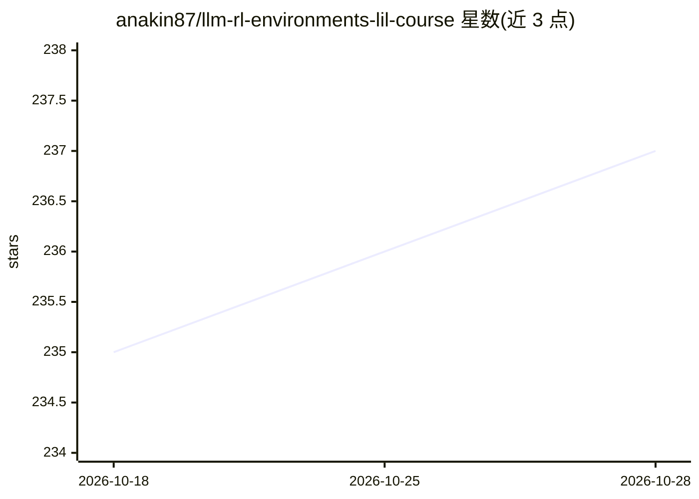

# anakin87/llm-rl-environments-lil-course

⭐ 239 · Python · Apache-2.0 · 推送 2026-05-27 · [GitHub](https://github.com/anakin87/llm-rl-environments-lil-course) · 个人维护

**面向 LLM 的强化学习环境小课程：构建井字棋环境训练小模型**

一门教程课程，讲解如何用强化学习环境评测与训练语言模型：从 RL 概念映射到 LLM 域讲起，使用 Verifiers 库构建井字棋 RL 环境，先做监督微调热身，再通过 RL 训练小语言模型 LiquidAI/LFM2-2.6B 下棋，并附失败实验复盘章节。课程共 10 章，配视频讲解和可对弈的在线 Demo，面向有 SFT 经验的 AI 工程师、传统 RL 从业者与好奇的动手者。作者声明与所列项目无隶属关系。

## 筛选速览

| 维度 | 判定 | 备注 |
|---|---|---|
| AI 角色 | `ai-knowledge` | 知识聚合/清单类 |
| 许可风险 | `permissive` | Apache-2.0 |
| 部署形态 | `None` |  |
| 模型依赖 | — | README 未给出锁定关系 |
| 硬件要求 | — | 无带数字的原话,不猜 |
| 安装摩擦 | `low` | 无编译、无系统依赖或容器化 |
| 成熟度 | — | 结构信号不足 |

## 能力要点

- 10 章内容覆盖从 RL 基础概念到 RL 训练实战
- 使用开源库 Verifiers 构建井字棋 RL 环境
- 将 LFM2-2.6B 训练为井字棋玩家
- 含失败实验复盘章节

## 适用场景

- AI 工程师从 SFT 过渡到学习 LLM 强化学习训练
- RL 从业者学习如何把 RL 应用于语言模型
- 想理解 reasoning 模型 RL 后训练原理的动手实践者

## 场景标签

`教程课程` `强化学习` · 领域:学习与行业

## 证据(README 行号)

> L5: A little course on Reinforcement Learning Environments for evaluating and training Language Models.
> L29: 1. Agents, Environments, and LLMs: mapping Reinforcement Learning concepts to the LLM domain.

## 星数曲线

2026-10-18 235 → 2026-10-28 237（+2）

---
*卡片 v1 · prompt 1.4 · 生成 2026-10-22 · 置信度 high · 依据 README sha `be97e0eae5a9` · [字段定义](../../DATASET.md)*
