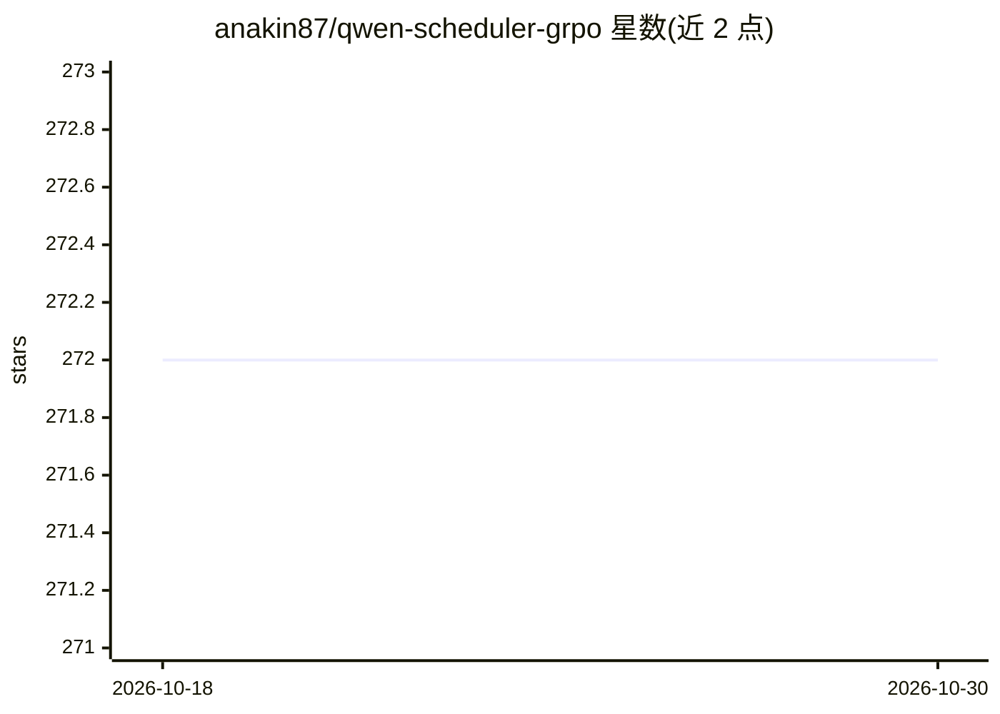

# anakin87/qwen-scheduler-grpo

⭐ 272 · Jupyter Notebook · Apache-2.0 · 推送 2026-04-08 · [GitHub](https://github.com/anakin87/qwen-scheduler-grpo) · 个人维护

**用 GRPO 训练 Qwen 模型从事件与优先级生成日程的实验仓库**

个人实验项目：使用 GRPO 强化学习方法训练 7B 语言模型，在只提供提示词与奖励函数（无监督目标输出）的条件下，学习根据事件列表与优先级生成加权总时长最大的日程安排。仓库包含数据集生成脚本、GRPO 训练 Notebook、提示词模板与推理评估脚本，训练结果与数据集、模型、Weights and Biases 报告一并公开。模型在格式遵循上表现良好，但重叠事件约束仍存在不足。

## 筛选速览

| 维度 | 判定 | 备注 |
|---|---|---|
| AI 角色 | `ai-native` | 本体是模型或模型工具 |
| 许可风险 | `permissive` | Apache-2.0 |
| 部署形态 | `None` |  |
| 模型依赖 | — | README 未给出锁定关系 |
| 硬件要求 | — | 无带数字的原话,不猜 |
| 安装摩擦 | `low` | 无编译、无系统依赖或容器化 |
| 成熟度 | — | 结构信号不足 |

## 能力要点

- GRPO 强化学习训练：仅用提示词与奖励函数，无目标输出
- 事件日程任务：按优先级加权最大化选中事件总时长
- 提供数据集生成、训练 Notebook、评估脚本与已发布模型

## 适用场景

- 学习如何为 LLM 设计 RL 训练任务与奖励函数
- 参考非数学/游戏类 GRPO 训练实验的完整流程
- 复用事件日程数据集与训练脚本做类似实验

## 场景标签

`强化学习` `微调` · 领域:训练与推理

## 证据(README 行号)

> L7: I used GRPO (Group Relative Policy Optimization), meaning the model is trained over time with Reinforcement Learning
> L8: some reward functions. This differs from Supervised Fine-Tuning methods: we are not showing the model any target

## 星数曲线

2026-10-18 272 → 2026-10-30 272（+0）

---
*卡片 v1 · prompt 1.4 · 生成 2026-10-22 · 置信度 high · 依据 README sha `7035e289e0a1` · [字段定义](../../DATASET.md)*
