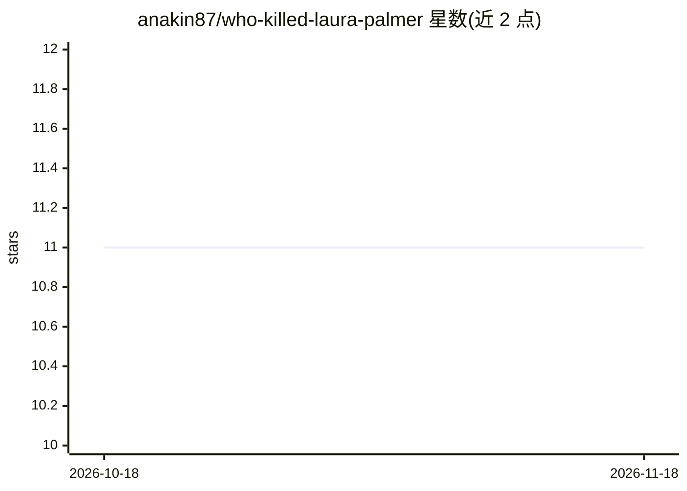

# anakin87/who-killed-laura-palmer

⭐ 11 · Jupyter Notebook · Apache-2.0 · 推送 2026-10-01 · [GitHub](https://github.com/anakin87/who-killed-laura-palmer) · 个人维护

**基于 Twin Peaks Wiki 数据的问答系统示例项目**

基于 Twin Peaks Wiki 爬取数据构建的问答系统：使用 Scrapy 与 fandom-py 爬取维基内容，用 Haystack 1.x 搭建问答 pipeline，以 Streamlit 开发 Web 应用并托管于 Hugging Face Spaces。仓库含爬虫、notebook（创建检索 pipeline 与生成问题）、数据与演示文稿，定位为学习如何用 Haystack 快速构建问答系统的示例项目。安装需 Python 3.10，reader 模型在 CPU 上运行。

## 筛选速览

| 维度 | 判定 | 备注 |
|---|---|---|
| AI 角色 | `ai-native` | 本体是模型或模型工具 |
| 许可风险 | `permissive` | Apache-2.0 |
| 部署形态 | `library` | 以包/库形式分发 |
| 模型依赖 | — | README 未给出锁定关系 |
| 硬件要求 | — | 无带数字的原话,不猜 |
| 安装摩擦 | `low` | 无编译、无系统依赖或容器化 |
| 成熟度 | — | 结构信号不足 |

## 能力要点

- Scrapy + fandom-py 爬取 Twin Peaks Wiki 数据
- Haystack 1.x 构建问答 pipeline
- Streamlit Web 应用，托管于 Hugging Face Spaces
- 含 Jupyter/Colab notebook 与 PyCon Italy 2022 演示材料

## 适用场景

- 学习如何用 Haystack 快速搭建问答系统
- 参考基于自有文档生成问题的做法
- 参考 Streamlit 应用部署到 Hugging Face Spaces 的流程

## 场景标签

`文档问答` `教程课程` · 领域:知识与检索

## 证据(README 行号)

> L18: WKLP is a simple Question Answering system, based on data crawled from Twin Peaks Wiki. It is built using 🔍 Haystac
> L27: * Question Answering pipelines: created with Haystack
> L32: - How to quickly ⌚ build a modern Question Answering system using 🔍 Haystack

## 星数曲线

2026-10-18 11 → 2026-11-18 11（+0）

---
*卡片 v1 · prompt 1.4 · 生成 2026-11-18 · 置信度 high · 依据 README sha `2ebc0fb64613` · [字段定义](../../DATASET.md)*
