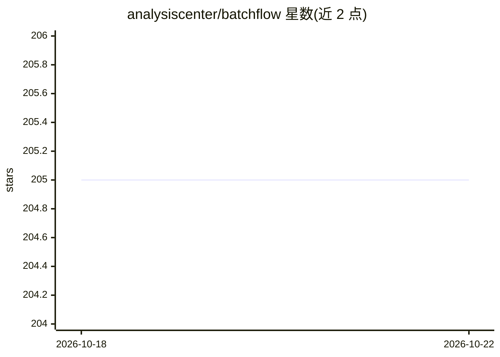

# analysiscenter/batchflow

⭐ 205 · Python · Apache-2.0 · 推送 2026-07-10 · [GitHub](https://github.com/analysiscenter/batchflow) · [官网](https://analysiscenter.github.io/batchflow/) · 组织维护

**Python 数据处理与 ML 工作流框架，支持超内存数据集**

面向数据科学家与 ML 开发者的 Python 框架：以链式 pipeline 定义随机/顺序批次的惰性数据处理动作，支持数据集与管道的 join/merge、批内并行与预取，可在数据集超过内存时工作；内置 VGG/ResNet 等 PyTorch 网络架构、模型配置与多进程并行训练的研究引擎。通过 PyPI（uv/poetry/pip）安装，提供 image/nn/research 等 extras 可选依赖。模块自述处于 beta 阶段。

## 筛选速览

| 维度 | 判定 | 备注 |
|---|---|---|
| AI 角色 | `ai-ecosystem` | LLM/agent 周边工具 |
| 许可风险 | `permissive` | Apache-2.0 |
| 部署形态 | `library` | 以包/库形式分发 |
| 模型依赖 | — | README 未给出锁定关系 |
| 硬件要求 | — | 无带数字的原话,不猜 |
| 安装摩擦 | `low` | 无编译、无系统依赖或容器化 |
| 成熟度 | `idea` | |

## 能力要点

- 链式 pipeline 定义惰性数据处理动作，支持超内存数据集
- 内置 VGG/Inception/ResNet 等 PyTorch 架构与 train_model 接口
- 批内并行、批预取与多进程研究/实验记录引擎
- 数据集与管道的 join/merge 操作

## 适用场景

- 为超大数据集构建可复用的批处理流水线
- 基于内置网络架构快速训练图像分类模型
- 并行运行多次模型实验并记录结果

## 场景标签

`MLOps` · 领域:训练与推理

## 证据(README 行号)

> L10: `BatchFlow` helps you conveniently work with random or sequential batches of your data
> L23: - ready to use ML models and proven NN architectures
> L25: - a powerful research engine with parallel model training and extended experiment logging.

## 星数曲线

2026-10-18 205 → 2026-10-22 205（+0）

---
*卡片 v1 · prompt 1.4 · 生成 2026-10-22 · 置信度 high · 依据 README sha `e103e512ea09` · [字段定义](../../DATASET.md)*
