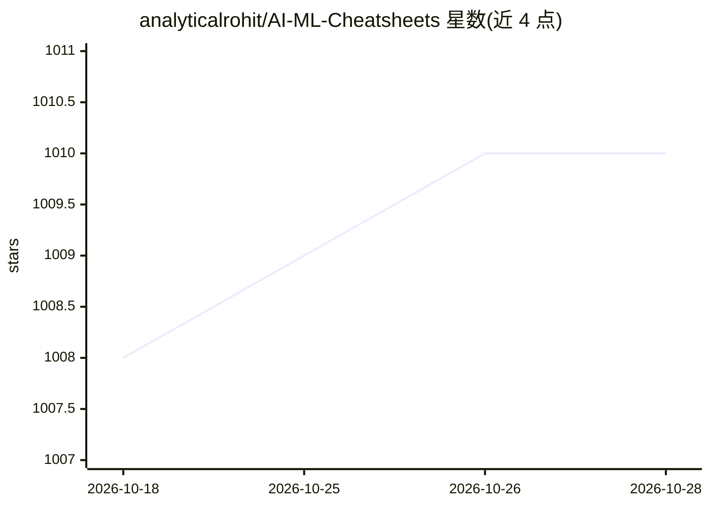

# analyticalrohit/AI-ML-Cheatsheets

⭐ 1,010 · MIT · 推送 2026-01-06 · [GitHub](https://github.com/analyticalrohit/AI-ML-Cheatsheets) · [官网](https://awesomeneuron.substack.com) · 个人维护

**斯坦福 AI/ML 速查表合集：学生与开发者快速查阅概念公式**

由个人维护的斯坦福速查表策展合集，按主题文件夹组织，覆盖人工智能、Transformers 与 LLM、深度学习、机器学习、概率统计、代数与微积分。每份速查表包含简要说明、图示与关键公式，定位是帮助学生、开发者与研究者快速回忆概念。获取方式为 git clone 仓库，另有社区贡献流程（Fork、分支、PR）。README 同时推广维护者的 AwesomeNeuron Newsletter。

## 筛选速览

| 维度 | 判定 | 备注 |
|---|---|---|
| AI 角色 | `ai-knowledge` | 知识聚合/清单类 |
| 许可风险 | `permissive` | MIT |
| 部署形态 | `None` |  |
| 模型依赖 | — | README 未给出锁定关系 |
| 硬件要求 | — | 无带数字的原话,不猜 |
| 安装摩擦 | `low` | 无编译、无系统依赖或容器化 |
| 成熟度 | — | 结构信号不足 |

## 能力要点

- 覆盖 AI、Transformers/LLM、深度学习、机器学习、概率统计、代数微积分等主题
- 按主题文件夹组织，含简要说明、图示与公式
- 提供社区贡献流程（Fork/分支/PR）

## 适用场景

- 学习或复习 AI/ML 核心概念与公式
- 备考或面试前快速查阅各主题要点
- 为教学或分享整理速查资料

## 场景标签

`精选清单` · 领域:学习与行业

## 证据(README 行号)

> L19: A curated collection of quick-reference stanford guides covering core topics in Artificial Intelligence, Machine Le
> L23: > All cheatsheets are organized folder-wise by topic and include concise explanations, diagrams, and essential equa

## 星数曲线

2026-10-18 1,008 → 2026-10-28 1,010（+2）

---
*卡片 v1 · prompt 1.4 · 生成 2026-10-21 · 置信度 high · 依据 README sha `cc337fa51a7e` · [字段定义](../../DATASET.md)*
