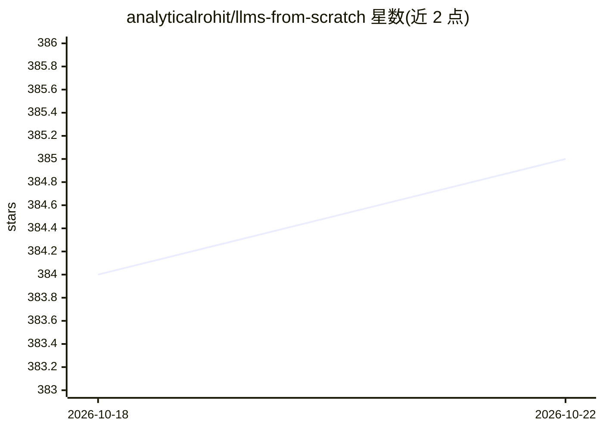

# analyticalrohit/llms-from-scratch

⭐ 385 · Jupyter Notebook · MIT · 推送 2026-06-08 · [GitHub](https://github.com/analyticalrohit/llms-from-scratch) · [官网](https://awesomeneuron.substack.com) · 个人维护

**用 PyTorch 从零分步构建类 ChatGPT LLM 的教学仓库**

面向学习者的 LLM 架构拆解教程：以 PyTorch 逐组件讲解 GPT 架构，覆盖分词、token/位置嵌入、自注意力与因果掩码、多头注意力、前馈网络、残差连接、层归一化与 Transformer Block，最终组装为可预测下一 token 的 MiniGPT。每个主题配有 Jupyter 交互笔记本（01–10 共 10 个）。依赖通过 pip requirements.txt 安装，CUDA 版 PyTorch 需按官方指引单独安装。内容配套作者的 Substack/YouTube 讲解。

## 筛选速览

| 维度 | 判定 | 备注 |
|---|---|---|
| AI 角色 | `ai-knowledge` | 知识聚合/清单类 |
| 许可风险 | `permissive` | MIT |
| 部署形态 | `library` | 以包/库形式分发 |
| 模型依赖 | — | README 未给出锁定关系 |
| 硬件要求 | — | 无带数字的原话,不猜 |
| 安装摩擦 | `medium` | 含编译或系统依赖之一 |
| 成熟度 | — | 结构信号不足 |

## 能力要点

- 分 10 个主题逐步拆解 GPT 架构组件
- 每组件配交互式 Jupyter 代码笔记本
- 组装 MiniGPT：嵌入+Transformer块+输出层的下一 token 预测
- 含自注意力逐步数学推导（QKV→缩放→softmax→上下文向量）

## 适用场景

- 我想理解 LLM 内部各组件的工作原理
- 跟随 Jupyter 笔记本动手实现每个架构组件
- 学习自注意力与多头注意力的数学细节

## 场景标签

`教程课程` · 领域:学习与行业

## 证据(README 行号)

> L20: This repository is a hands on guide to building a ChatGPT like LLM in PyTorch. It breaks the architecture into simp
> L38: Dive into the hands-on examples for each LLM component using interactive Jupyter notebooks.

## 星数曲线

2026-10-18 384 → 2026-10-22 385（+1）

---
*卡片 v1 · prompt 1.4 · 生成 2026-10-21 · 置信度 high · 依据 README sha `bd4166101a28` · [字段定义](../../DATASET.md)*
