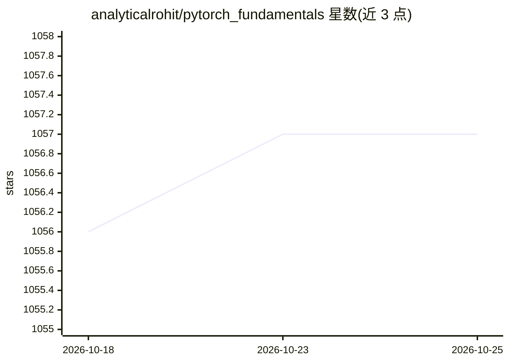

# analyticalrohit/pytorch_fundamentals

⭐ 1,057 · Jupyter Notebook · MIT · 推送 2026-01-06 · [GitHub](https://github.com/analyticalrohit/pytorch_fundamentals) · [官网](https://awesomeneuron.substack.com) · 个人维护

**PyTorch 基础入门教程库：张量初始化、运算、索引与重塑**

面向深度学习初学者的 PyTorch 基础教学内容仓库，以 Jupyter notebook 形式提供张量初始化、运算、索引、重塑等动手示例，主题标签还覆盖 broadcasting、矩阵乘法与 NumPy。通过 pip install -r requirements.txt 安装依赖；如需 CUDA 版 torch，需按 PyTorch 官网的对应命令安装。作者同时运营 AwesomeNeuron Newsletter 与配套博客，仓库采用 MIT 许可。

## 筛选速览

| 维度 | 判定 | 备注 |
|---|---|---|
| AI 角色 | `ai-knowledge` | 知识聚合/清单类 |
| 许可风险 | `permissive` | MIT |
| 部署形态 | `library` | 以包/库形式分发 |
| 模型依赖 | — | README 未给出锁定关系 |
| 硬件要求 | — | 无带数字的原话,不猜 |
| 安装摩擦 | `medium` | 含编译或系统依赖之一 |
| 成熟度 | — | 结构信号不足 |

## 能力要点

- 以交互式 Jupyter notebook 提供动手示例
- 覆盖张量初始化、运算、索引、重塑等 PyTorch 基础
- README 提示 CUDA 版 torch 需按官方命令安装

## 适用场景

- 初学 PyTorch 时按 notebook 逐步练习张量操作
- 作为深度学习入门课程的配套代码
- 配合作者的博客与 Newsletter 学习基础概念

## 场景标签

`教程课程` · 领域:学习与行业

## 证据(README 行号)

> L17: # PyTorch Fundamentals: Your First Steps into Hands-on Deep Learning
> L20: Introduction to PyTorch fundamentals, covering tensor initialization, operations, indexing, and reshaping.

## 星数曲线

2026-10-18 1,056 → 2026-10-25 1,057（+1）

---
*卡片 v1 · prompt 1.4 · 生成 2026-10-21 · 置信度 high · 依据 README sha `f000a872bc8a` · [字段定义](../../DATASET.md)*
