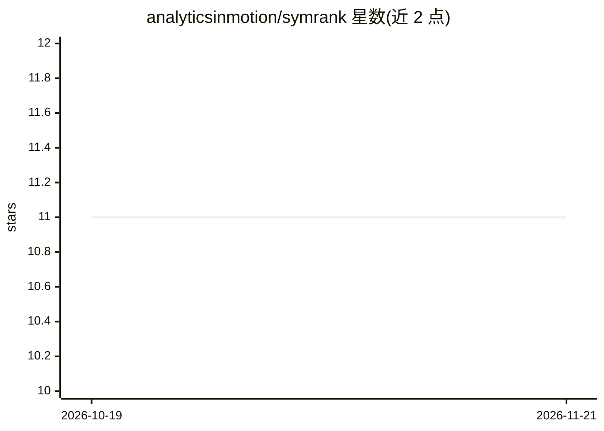

# analyticsinmotion/symrank

⭐ 11 · Python · Apache-2.0 · 推送 2026-03-11 · [GitHub](https://github.com/analyticsinmotion/symrank) · 组织维护

**RAG 管线的 Python 余弦相似度 top-k 排序库**

SymRank 是一个 Python 库，提供向量检索与 RAG 场景下的 top-k 余弦相似度排序；核心引擎以 Rust + SIMD 实现，通过两个 API（cosine_similarity_matrix 与 cosine_similarity）适配矩阵候选集与流式 (id, vector) 对两类输入，按工作负载自动选择串行/并行模式，并支持分批处理以控制内存。支持 Python 3.10-3.14，以 Apache 2.0 许可发布于 PyPI。README 含与 NumPy、scikit-learn 的基准数据（Windows 环境测得），并给出按候选集形态选择 API 的决策指南。

## 筛选速览

| 维度 | 判定 | 备注 |
|---|---|---|
| AI 角色 | `ai-native` | 本体是模型或模型工具 |
| 许可风险 | `permissive` | Apache-2.0 |
| 部署形态 | `library` | 以包/库形式分发 |
| 模型依赖 | — | README 未给出锁定关系 |
| 硬件要求 | — | 无带数字的原话,不猜 |
| 安装摩擦 | `low` | 无编译、无系统依赖或容器化 |
| 成熟度 | — | 结构信号不足 |

## 能力要点

- Rust + SIMD 后端，按负载自动选择串行/并行模式
- 两个 API：矩阵输入（性能优先）与列表输入（灵活性优先）
- 可选 batch_size 分批处理以降低内存占用
- 输出按相似度降序的 (id, score) 字典列表

## 适用场景

- RAG 检索流程中对候选嵌入做 top-k 重排
- 向量匹配场景下对预存 NumPy 嵌入矩阵批量查询
- 对混合或流式来源的 (id, vector) 候选做排序

## 场景标签

`RAG` `语义搜索` · 领域:知识与检索

## 证据(README 行号)

> L17: **SymRank** is a blazing-fast Python library for top-k cosine similarity ranking, designed for vector search, retri
> L19: Built with a Rust + SIMD backend, it offers the speed of native code with the ease of Python.

## 星数曲线

2026-10-19 11 → 2026-11-21 11（+0）

---
*卡片 v1 · prompt 1.4 · 生成 2026-11-18 · 置信度 high · 依据 README sha `da5e484efbc7` · [字段定义](../../DATASET.md)*
