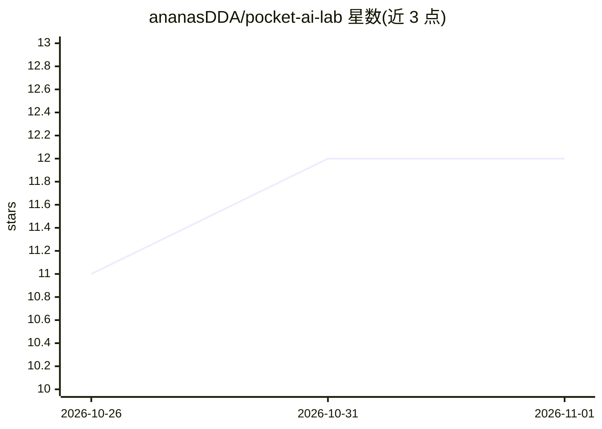

# ananasDDA/pocket-ai-lab

⭐ 12 · Swift · MIT · 推送 2026-10-28 · [GitHub](https://github.com/ananasDDA/pocket-ai-lab) · [官网](https://ananasdda.github.io/pocket-ai-lab/) · 个人维护

**iPhone 端离线运行 LLM 的应用：多后端推理与模型适配检测**

面向 iPhone 用户的本地大模型聊天应用：扫描设备芯片、RAM、磁盘与 iOS 实际进程内存配额，据此过滤 Hugging Face 模型目录并给出能否运行的判定，然后下载模型并离线流式聊天。推理后端支持 MLX、llama.cpp (GGUF)、Core ML 与 Apple Intelligence，运行时可切换；支持文本、视觉模型的图像/视频帧输入及 whisper.cpp 语音转文字。可通过粘贴 Hugging Face 链接导入任意模型并选择量化。要求 iOS 26+、iPhone 15 或更新机型（本地模型需 6GB+ RAM），需 Xcode 26+ 自行构建，不提供安装包。

## 筛选速览

| 维度 | 判定 | 备注 |
|---|---|---|
| AI 角色 | `ai-native` | 本体是模型或模型工具 |
| 许可风险 | `permissive` | MIT |
| 部署形态 | `None` |  |
| 模型依赖 | local-ok | 支持本地模型 |
| 硬件要求 | — | 无带数字的原话,不猜 |
| 安装摩擦 | `low` | 无编译、无系统依赖或容器化 |
| 成熟度 | — | 结构信号不足 |

## 能力要点

- MLX / llama.cpp / Core ML / Apple Intelligence 四后端运行时可切换
- 基于设备真实进程内存配额（jetsam / Metal working set）的模型适配判定
- 粘贴 Hugging Face 链接导入任意模型，量化前先给出 RAM/磁盘判定
- 文本、图像/视频帧输入与 whisper.cpp 语音转文字的多模态支持

## 适用场景

- 在 iPhone 上离线运行 Hugging Face 开源模型聊天
- 不确定机型能跑哪个模型时，按设备实际内存判定选型
- 在手机上对图像、视频帧提问或做语音转文字

## 场景标签

`聊天机器人` `多模态` `语音识别` · 领域:对话与助手

## 证据(README 行号)

> L15: Pocket AI Lab scans your device, tells you honestly which models will actually fit, downloads them straight from Hu
> L17: - **Multi-backend inference** — MLX, llama.cpp (GGUF), Core ML, and Apple Intelligence, switchable at runtime

## 星数曲线

2026-10-26 11 → 2026-11-01 12（+1）

---
*卡片 v1 · prompt 1.4 · 生成 2026-11-01 · 置信度 high · 依据 README sha `6c9737b53eb3` · [字段定义](../../DATASET.md)*
