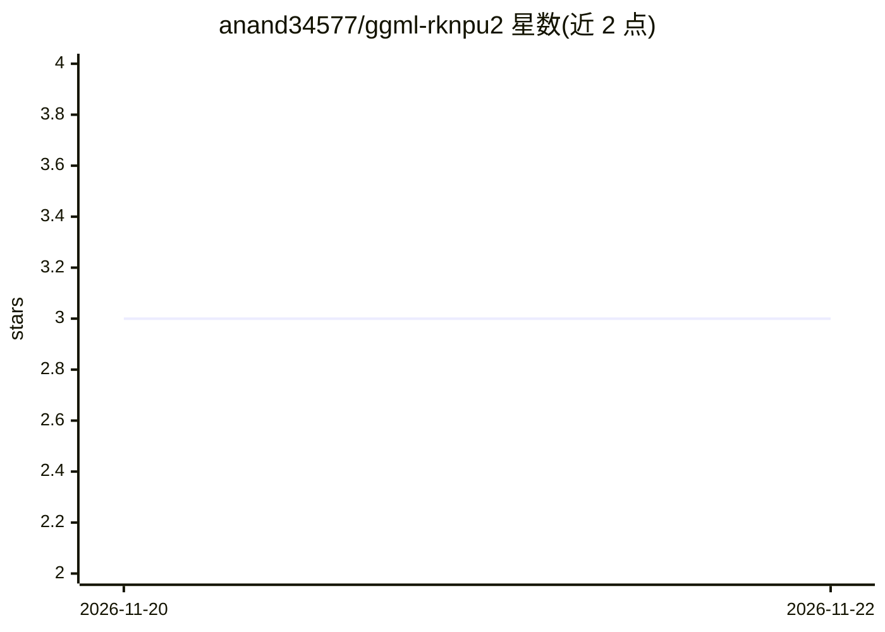

# anand34577/ggml-rknpu2

⭐ 3 · C++ · MIT · 推送 2026-10-24 · [GitHub](https://github.com/anand34577/ggml-rknpu2) · [官网](https://github.com/anand34577/ggml-rknpu2/wiki) · 个人维护

**在 Rockchip NPU 上运行 llama.cpp 的 ggml 后端**

为 RK3588/RK3576/RK3566/RK3568/RK3562 提供的 llama.cpp 计算后端：把长 prompt 的批量矩阵乘法交给 NPU，逐词生成留在 CPU，NPU 无法处理的部分自动回退到 CPU。附带 llama-npu 命令封装聊天、Web 服务、OpenAI 兼容 API、基准测试与环境检查；NPU 权重副本默认占用上限 3 GB 内存。提供一行安装脚本与源码构建两种方式，需要 Rockchip vendor kernel 与 4 GB 以上内存。

## 筛选速览

| 维度 | 判定 | 备注 |
|---|---|---|
| AI 角色 | `ai-ecosystem` | LLM/agent 周边工具 |
| 许可风险 | `permissive` | MIT |
| 部署形态 | `None` |  |
| 模型依赖 | local-ok | 支持本地模型 |
| 硬件要求 | — | 无带数字的原话,不猜 |
| 安装摩擦 | `medium` | 含编译或系统依赖之一 |
| 成熟度 | — | 结构信号不足 |

## 能力要点

- llama.cpp 的 ggml 后端，prefill 批量矩阵乘走 NPU、decode 留在 CPU
- llama-npu 命令封装 chat/serve/bench/check/devices 等子命令
- serve 同时提供 8080 端口的 Web 聊天与 OpenAI 兼容 API（/v1/chat/completions）
- NPU 路径不可用时静默回退 CPU，测试校验两者输出一致

## 适用场景

- 在 RK3588 等板子上用 NPU 加速本地 LLM 的 prompt 处理
- 在开发机上通过 OpenAI 兼容 API 调用跑在板子上的模型
- 用 bench 对比开/关 NPU 的推理速度

## 场景标签

`推理引擎` · 领域:训练与推理

## 证据(README 行号)

> L17: ggml-rknpu2 is a llama.cpp backend that hands those multiplications to the NPU. In practice:
> L171: The backend plugs into ggml, llama.cpp's compute library, like the CUDA or Vulkan backends do.

## 星数曲线

2026-11-20 3 → 2026-11-22 3（+0）

---
*卡片 v1 · prompt 1.4 · 生成 2026-11-22 · 置信度 high · 依据 README sha `aaf3bf7b9523` · [字段定义](../../DATASET.md)*
