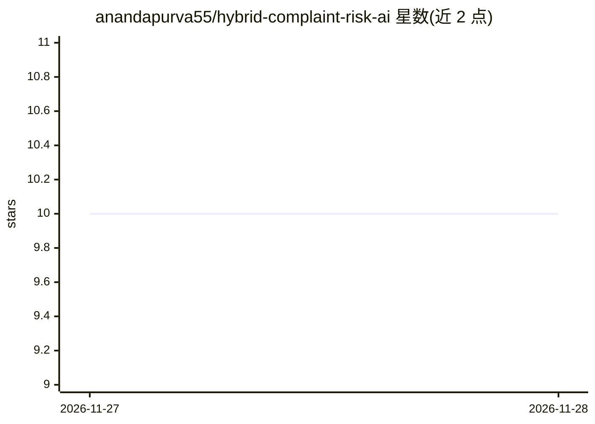

# anandapurva55/hybrid-complaint-risk-ai

⭐ 10 · Python · 推送 2026-11-19 · [GitHub](https://github.com/anandapurva55/hybrid-complaint-risk-ai) · 个人维护

**客户反馈不满度分诊系统：模型输出风险层级与人工处理建议**

读取客户反馈文本，输出三个判断：不满程度（low/medium/high）、后续动作（自动回复/人工审查/升级）及英文解释。流程为微调 DistilBERT（int8 权重）给出三类概率，经温度校准与阈值调优的 NumPy 决策层转为决策，五个确定性审查触发规则决定是否需人工介入；Amazon Bedrock 上的 Nova Lite 仅生成解释，无法更改决策。标注来自 Kaggle 服装评论星级代理标签，提供 rating_to_risk 换标接口。以 FastAPI 服务部署于 AWS ECS Fargate，无 Bedrock 凭据时走本地 fallback 解释。

## 筛选速览

| 维度 | 判定 | 备注 |
|---|---|---|
| AI 角色 | `ai-native` | 本体是模型或模型工具 |
| 许可风险 | `none` | — |
| 部署形态 | `self-host` | docker 或自建部署 |
| 模型依赖 | — | README 未给出锁定关系 |
| 硬件要求 | — | 无带数字的原话,不猜 |
| 安装摩擦 | `low` | 无编译、无系统依赖或容器化 |
| 成熟度 | — | 结构信号不足 |

## 能力要点

- DistilBERT 三类概率 + 温度校准 + 验证集网格搜索阈值
- 五个确定性审查触发规则（冲突/低置信/短文本/乱拼写/非英文）
- LLM 仅生成解释，recommended_action 与 human_review_required 由规则覆盖
- 无 Bedrock 访问时 fallback 解释，LLM_PROVIDER=none 可跳过调用

## 适用场景

- 对英文产品反馈做优先级排序并路由给人工审查
- 对明显正面消息自动确认回复
- 替换 rating_to_risk 后用自己的真实升级结果重训流水线

## 场景标签

`微调` `MLOps` · 领域:训练与推理

## 证据(README 行号)

> L20: A system that reads a piece of customer feedback and answers three practical questions: **how unhappy is this custo
> L81: Each piece of feedback goes to a **DistilBERT** model, **fine-tuned** on the reviews, which outputs three probabili
> L126: A "low" case that trips any trigger is never auto-replied: `action_for` turns it into `manual_review`. After the *

## 星数曲线

2026-11-27 10 → 2026-11-28 10（+0）

---
*卡片 v1 · prompt 1.4 · 生成 2026-11-27 · 置信度 high · 依据 README sha `da312440e91a` · [字段定义](../../DATASET.md)*
