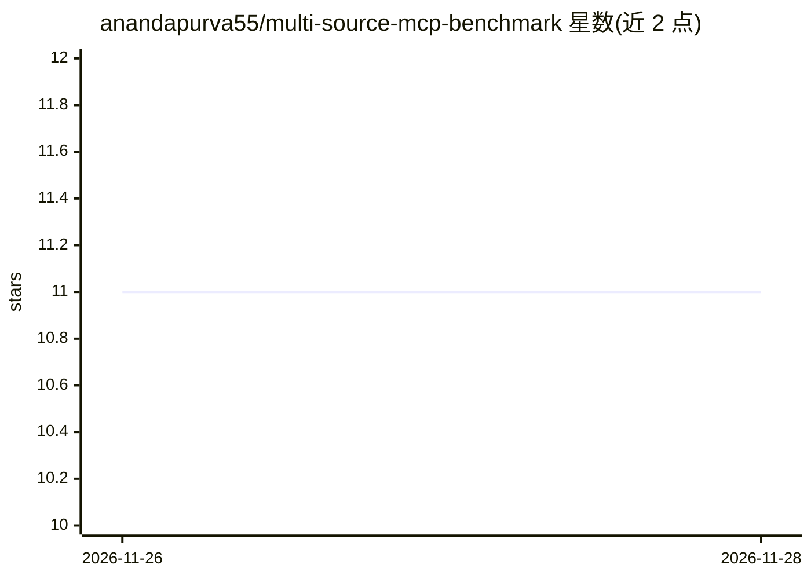

# anandapurva55/multi-source-mcp-benchmark

⭐ 11 · Python · MIT · 推送 2026-11-22 · [GitHub](https://github.com/anandapurva55/multi-source-mcp-benchmark) · 个人维护

**评测工具型 AI agent 处理相互矛盾证据的 MCP 基准**

通过三个场景（对账核对、性能声明核查、故障根因）测试 agent 在多个互相矛盾的证据来源中判断可信度的能力。agent 经 MCP 协议（文件系统、代码执行、git、计算器四个服务）在无网络的 Docker 沙箱内读取只读文件并运行代码，产出回答后由经过校准的裁判模型按逐条事实声明打分，支持部分得分与错误结论扣分。默认 agent 为经 Ollama 本地运行的 Qwen 2.5 7B，裁判为 GPT-4.1-mini。仓库未运行过前沿模型。

## 筛选速览

| 维度 | 判定 | 备注 |
|---|---|---|
| AI 角色 | `ai-ecosystem` | LLM/agent 周边工具 |
| 许可风险 | `permissive` | MIT |
| 部署形态 | `self-host` | docker 或自建部署 |
| 模型依赖 | local-ok | 支持本地模型 |
| 硬件要求 | — | 无带数字的原话,不猜 |
| 安装摩擦 | `low` | 无编译、无系统依赖或容器化 |
| 成熟度 | — | 结构信号不足 |

## 能力要点

- 3 个场景、每场景 5-8 个证据文件与 7-8 条被评分声明
- 无网络沙箱（network_mode: none、只读根文件系统、能力全部移除）防止 agent 查阅公开答案
- 裁判模型先通过 15 个校准用例再使用，逐条声明打分并扣减错误结论
- make up 构建、pytest 运行、证据文件由代码生成可复现

## 适用场景

- 评估 agent 在证据互相冲突时选择可信来源的能力
- 为本地模型建立可复现的 agent 工具调用基线
- 检验裁判模型打分的公平性后再用于评分

## 场景标签

`模型评测` `代码生成` · 领域:编码与开发

## 证据(README 行号)

> L5: This project tests that missing skill. Each scenario gives an agent a business question, a Docker container, and fil
> L112: Architecture: a local agent model (Qwen 2.5 7B via Ollama) reaches MCP tools inside a no-network sandbox over dock
> L128: 4. A second AI model, the judge (`gpt-4.1-mini` by default), reads that answer and checks it against the list of f

## 星数曲线

2026-11-26 11 → 2026-11-28 11（+0）

---
*卡片 v1 · prompt 1.4 · 生成 2026-11-26 · 置信度 mid · 依据 README sha `c9eb5326ca67` · [字段定义](../../DATASET.md)*
