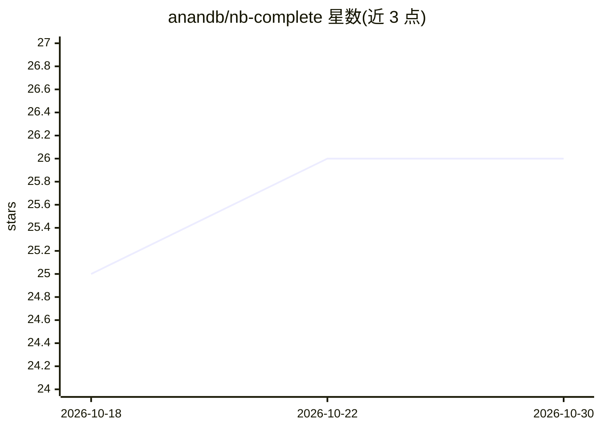

# anandb/nb-complete

⭐ 26 · Java · Apache-2.0 · 推送 2026-10-29 · [GitHub](https://github.com/anandb/nb-complete) · 个人维护

**NetBeans IDE 的 AI 结对话编程插件，经 ACP 接入多种编码代理**

BeanBot 是一个 NetBeans 插件，通过 Agent Client Protocol（JSON-RPC over stdin/stdout）接入 12 种编码代理（Claude、Cursor、OpenCode、Goose、Copilot、Gemini 等），在 IDE 内提供结构化聊天界面，支持代码生成、项目分析与自动化任务执行。内置 MCP 服务器向 AI 客户端暴露编辑器上下文、文件系统、git/hg、任务等工具集；token 与费用统计来自 ACP 流量并存入嵌入式 H2 数据库。采用六边形（ports & adapters）架构分层组织。从源码经 Maven 构建生成 NBM 后经 NetBeans 插件管理器安装。

## 筛选速览

| 维度 | 判定 | 备注 |
|---|---|---|
| AI 角色 | `ai-ecosystem` | LLM/agent 周边工具 |
| 许可风险 | `permissive` | Apache-2.0 |
| 部署形态 | `None` |  |
| 模型依赖 | — | README 未给出锁定关系 |
| 硬件要求 | — | 无带数字的原话,不猜 |
| 安装摩擦 | `low` | 无编译、无系统依赖或容器化 |
| 成熟度 | — | 结构信号不足 |

## 能力要点

- 通过 ACP 支持 12 种编码代理（Claude、Cursor、OpenCode、Goose、Copilot 等）
- 内置 MCP 服务器暴露编辑器上下文、文件系统、git/hg、任务与项目工具集
- token 与费用统计从 ACP 流量记录并持久化到嵌入式 H2 数据库，按模型/代理分列
- todo.txt 格式任务仓库集成，兼容标准 todo.txt 工具

## 适用场景

- 在 NetBeans 内与 AI 结对话编程，生成、解释与重构代码
- 让编码代理读取编辑器打开的标签页并控制编辑器导航
- 在 IDE 内统计各模型与代理的 token 用量和费用

## 场景标签

`代码生成` `编码 Agent` · 领域:编码与开发

## 证据(README 行号)

> L11: BeanBot is a NetBeans IDE plugin designed to provide integrated AI capabilities through the Agent Client Protocol (
> L19: Supported coding harnesses: **Oh My Pi, OpenCode, Codex, OpenClaw, Pi, Goose, Cursor, Copilot, Claude, Hermes, Gemi

## 星数曲线

2026-10-18 25 → 2026-10-30 26（+1）

---
*卡片 v1 · prompt 1.4 · 生成 2026-10-26 · 置信度 high · 依据 README sha `7f8329a6a2aa` · [字段定义](../../DATASET.md)*
