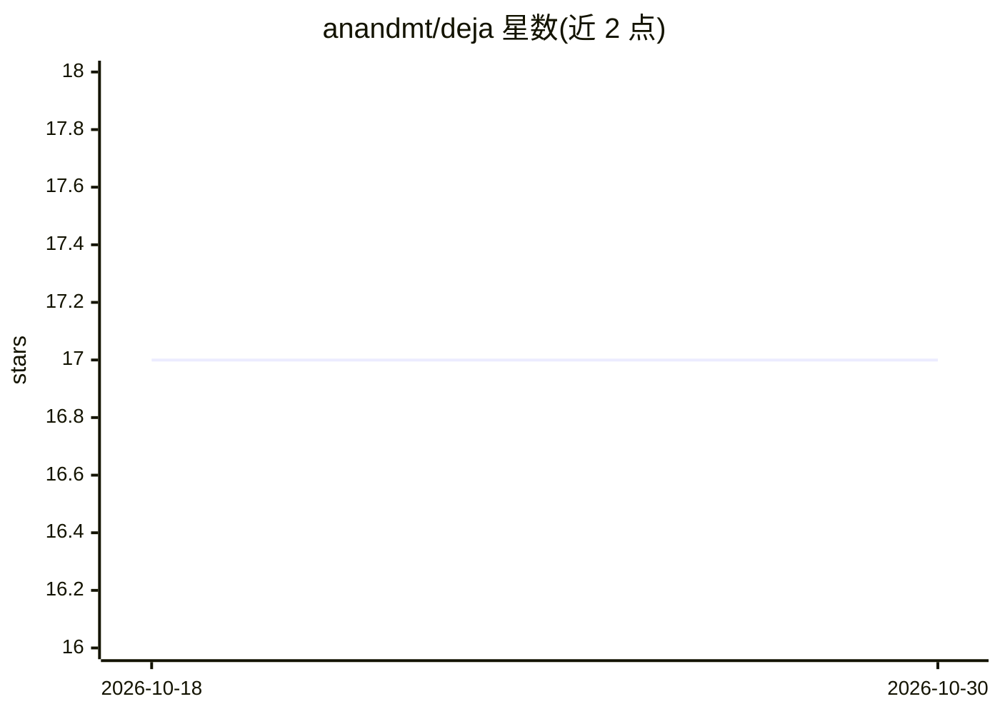

# anandmt/deja

⭐ 17 · TypeScript · 推送 2026-05-30 · [GitHub](https://github.com/anandmt/deja) · [官网](https://www.npmjs.com/package/@anandt/deja) · 个人维护

**给 Claude Code 加跨会话持久记忆的本地插件**

通过 Claude Code 的 hooks 与 MCP 机制自动记录会话中的文件编辑、命令、决策等事件，存入本地 SQLite（~/.deja/memory.db），并在每次新会话开始时注入最相关的上下文（默认 8000 字符预算，200ms 内完成）。提供 deja_search/deja_timeline/deja_observe 三个 MCP 工具供会话内检索，分层设计：Tier 0 启发式提取 + FTS5 全文搜索为默认完整功能，Tier 1 为 tree-sitter AST 解析（可选），向量与 LLM 层为规划中。全程本地运行，无 API key、无遥测；macOS/Linux 需 Bun >= 1.3.6（可自动安装），Windows 支持但需手动安装 Bun。附带本地 Web 仪表盘（端口 19533）。

## 筛选速览

| 维度 | 判定 | 备注 |
|---|---|---|
| AI 角色 | `ai-ecosystem` | LLM/agent 周边工具 |
| 许可风险 | `none` | — |
| 部署形态 | `library` | 以包/库形式分发 |
| 模型依赖 | — | README 未给出锁定关系 |
| 硬件要求 | — | 无带数字的原话,不猜 |
| 安装摩擦 | `low` | 无编译、无系统依赖或容器化 |
| 成熟度 | — | 结构信号不足 |

## 能力要点

- hooks 自动捕获事件，约 30-40% 噪音事件被自动过滤
- 会话开始时注入上下文（默认 8000 字符预算，<200ms）
- 三个 MCP 工具（搜索/时间线/详情）支持会话内自主检索记忆
- 单文件 SQLite 存储，WAL 模式多会话安全，零配置无 API key

## 适用场景

- 让 Claude Code 在新会话中记得之前的决策与文件改动
- 跨会话回查某次技术讨论（如缓存方案）的上下文
- 通过本地仪表盘浏览观察时间线与会话摘要

## 场景标签

`Agent 记忆` · 领域:Agent 开发

## 证据(README 行号)

> L36: **deja gives Claude a memory.** It silently observes your sessions — files touched, commands run, decisions made — 
> L112:     A[Claude Code] -->|hooks| B[Worker]
> L178: deja install               Install hooks + MCP server (~/.claude/settings.json)

## 星数曲线

2026-10-18 17 → 2026-10-30 17（+0）

---
*卡片 v1 · prompt 1.4 · 生成 2026-10-29 · 置信度 high · 依据 README sha `3cd14940f76e` · [字段定义](../../DATASET.md)*
