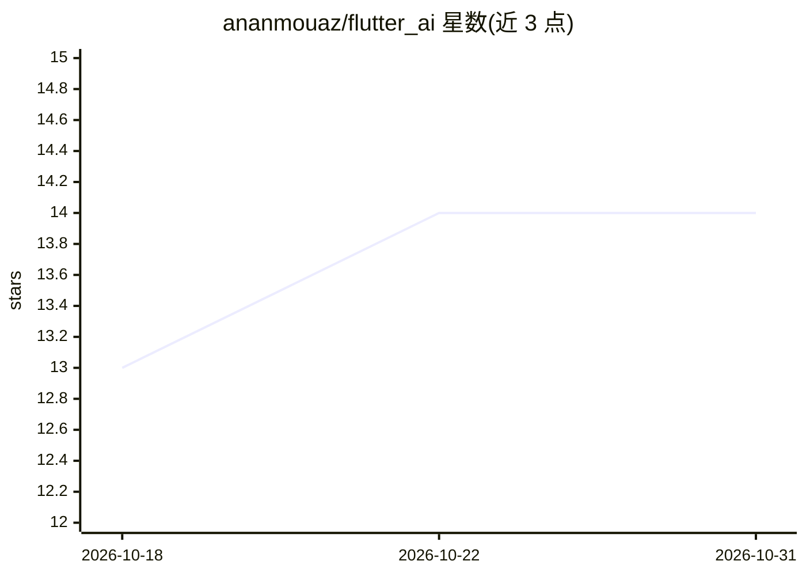

# ananmouaz/flutter_ai

⭐ 14 · Dart · BSD-3-Clause · 推送 2026-10-03 · [GitHub](https://github.com/ananmouaz/flutter_ai) · [官网](https://pub.dev/packages/flutter_ai_elements) · 个人维护

**Flutter AI 聊天工具包：流式对话、工具调用、生成式 UI 与语音**

面向 Flutter 开发者的 AI 聊天构建工具包，由一组小型 pub 包组成：core（LlmProvider 等契约）、client（UseChatController 会话控制器）、elements（30+ UI 组件）、providers（OpenAI/Anthropic/Gemini）、tools、mcp、voice。提供流式聊天、工具调用与 MCP 集成、引用溯源、生成式 UI（工具结果渲染为 Flutter widget）与引擎无关的语音输入。不绑定状态管理方案；Pre-1.0，API 可能在次要版本间变更。

## 筛选速览

| 维度 | 判定 | 备注 |
|---|---|---|
| AI 角色 | `ai-ecosystem` | LLM/agent 周边工具 |
| 许可风险 | `permissive` | BSD-3-Clause |
| 部署形态 | `None` |  |
| 模型依赖 | — | README 未给出锁定关系 |
| 硬件要求 | — | 无带数字的原话,不猜 |
| 安装摩擦 | `low` | 无编译、无系统依赖或容器化 |
| 成熟度 | `idea` | |

## 能力要点

- provider 无关（OpenAI/Anthropic/Gemini）与状态管理器无关的包族架构
- 工具调用与 MCP 服务器集成，含工具运行前的审批门控
- 生成式 UI：工具结果渲染为可交互 Flutter widget
- 30+ UI 组件与统一 AiThemeExtension 主题（明/暗）

## 适用场景

- 在 Flutter 应用中快速搭建带流式输出的 AI 聊天界面
- 为聊天 agent 接入工具调用、MCP 服务器与引用溯源
- 从 Vercel AI SDK 迁移到 Flutter 技术栈（附迁移指南）

## 场景标签

`Agent 框架` · 领域:Agent 开发

## 证据(README 行号)

> L17: **Build AI chat in Flutter in minutes.** A family of small, focused packages —
> L134: |`flutter_ai_core`|Foundation (pure Dart): models, `AiStreamEvent`, `MessageProcessor`, `LlmProvider` & renderer c
> L141: |`flutter_ai_provider_anthropic`|Anthropic (Claude) Messages API provider|

## 星数曲线

2026-10-18 13 → 2026-10-31 14（+1）

---
*卡片 v1 · prompt 1.4 · 生成 2026-10-31 · 置信度 high · 依据 README sha `1e35bef990d4` · [字段定义](../../DATASET.md)*
