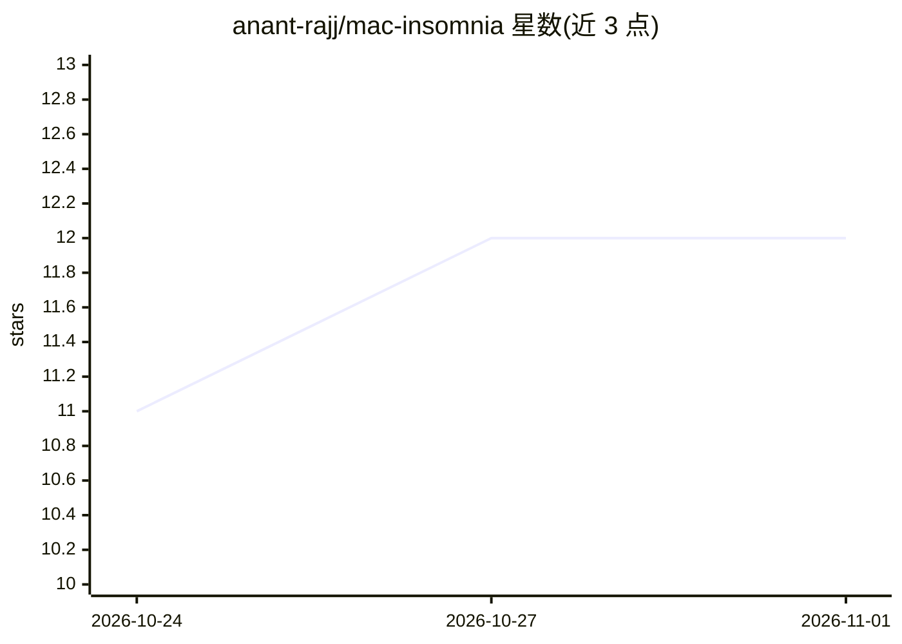

# anant-rajj/mac-insomnia

⭐ 12 · Python · MIT · 推送 2026-10-31 · [GitHub](https://github.com/anant-rajj/mac-insomnia) · 个人维护

**macOS 合盖保持唤醒的轻量 CLI 工具，供本机跑 LLM 与后台任务**

通过 `pmset -a disablesleep` 控制 macOS 睡眠，使 MacBook 合盖后仍继续运行本地 LLM、AI agent、训练与下载等任务。体积约 24 KB、无驻留 GUI，提供 start/stop/status、命令包装（wrap）在命令运行期间保持唤醒，合盖时轮询传感器并将内屏背光降至 0，电量低于 15% 自动恢复睡眠，POSIX 信号陷阱保证退出时还原设置。需管理员权限配置 sudoers 规则以免密切换睡眠设置。

## 筛选速览

| 维度 | 判定 | 备注 |
|---|---|---|
| AI 角色 | `ai-ecosystem` | LLM/agent 周边工具 |
| 许可风险 | `permissive` | MIT |
| 部署形态 | `None` |  |
| 模型依赖 | local-ok | 支持本地模型 |
| 硬件要求 | — | 无带数字的原话,不猜 |
| 安装摩擦 | `low` | 无编译、无系统依赖或容器化 |
| 成熟度 | — | 结构信号不足 |

## 能力要点

- wrap 命令包装：仅在指定命令运行期间保持合盖唤醒
- 合盖时轮询传感器并通过 DisplayServices 框架将内屏背光降至 0%
- 电量 ≤15% 自动恢复睡眠并终止，信号陷阱保证 disablesleep 还原
- 约 24 KB 体积、0 MB 空闲内存，无后台守护进程常驻

## 适用场景

- 合盖状态下继续跑本地模型推理或长训练任务
- 夜间运行 AI agent、评测脚本或大文件下载不被睡眠中断
- 替代重量级菜单栏防睡眠应用，按需命令行控制

## 场景标签

 · 领域:系统工具/电源管理

## 证据(README 行号)

> L3: > **Ultra-lightweight, zero-bloat macOS lid-closed stay-awake CLI tool for AI agents, local LLMs, and background job
> L10: Keep your MacBook running with the lid closed without external displays or heavy menu-bar apps. Built specifically 

## 星数曲线

2026-10-24 11 → 2026-11-01 12（+1）

---
*卡片 v1 · prompt 1.4 · 生成 2026-11-01 · 置信度 mid · 依据 README sha `59a492255238` · [字段定义](../../DATASET.md)*
