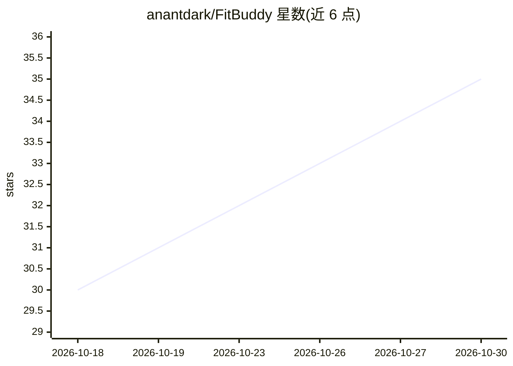

# anantdark/FitBuddy

⭐ 35 · Kotlin · GPL-3.0 · 推送 2026-10-29 · [GitHub](https://github.com/anantdark/FitBuddy) · [官网](https://anantdark.github.io/FitBuddy/) · 个人维护

**Android 健身与卡路里追踪应用，拍照或文字由 LLM 估算热量**

面向个人用户的 Android 健康记录应用（GPL-3.0，MVVM + Room 架构）：通过照片或松散文本记录饮食与运动，由可配置的 LLM（OpenRouter/Gemini/OpenAI/Ollama 兼容端点）解析食物并估算热量与宏量营养素；无 API key 时回退到内置离线模拟器。提供区域包（本地化提示词与主食）、可编辑的餐食复核（调整食材克重实时重算宏量）、预设收藏、Canvas 图表与 30 天滚动分析、AES-256-GCM 加密备份。经 F-Droid/OpenAPK/GitHub Releases 分发，arm64-v8a APK。

## 筛选速览

| 维度 | 判定 | 备注 |
|---|---|---|
| AI 角色 | `ai-native` | 本体是模型或模型工具 |
| 许可风险 | `viral` | GPL-3.0 |
| 部署形态 | `None` |  |
| 模型依赖 | local-ok | 支持本地模型 |
| 硬件要求 | — | 无带数字的原话,不猜 |
| 安装摩擦 | `medium` | 含编译或系统依赖之一 |
| 成熟度 | — | 结构信号不足 |

## 能力要点

- 照片/文本输入由 LLM 解析食物与运动并估算热量宏量
- 区域包：按地区定制 AI 提示词、主食与份量用语
- 无 API key 时用内置离线模拟器运行
- AES-256-GCM 加密本地与云端备份

## 适用场景

- 拍照或随手一句话记录三餐与运动，自动估算热量
- 追踪体重、体脂、BMR 与肌肉量等身体目标
- 按自己所在地区获得本地化的食物份量表达与示例

## 场景标签

 · 领域:健康/健身应用

## 证据(README 行号)

> L3: AI-powered health tracker for Android with region-aware diets and daily routines. Log meals and workouts with a phot
> L19: - **Smart logging** — photo or text input; AI parses food and exercise

## 星数曲线

2026-10-18 30 → 2026-10-30 35（+5）

---
*卡片 v1 · prompt 1.4 · 生成 2026-10-25 · 置信度 high · 依据 README sha `84191f4303b5` · [字段定义](../../DATASET.md)*
