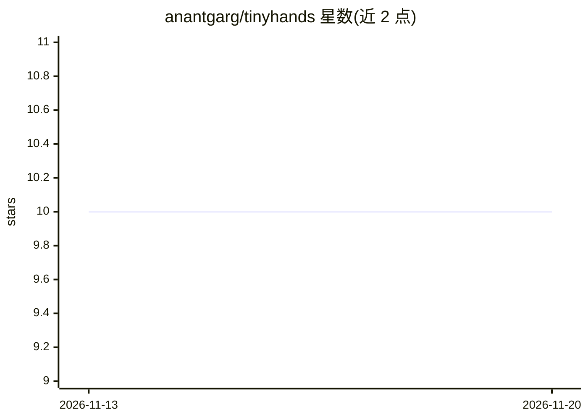

# anantgarg/tinyhands

⭐ 10 · TypeScript · MIT · 推送 2026-07-03 · [GitHub](https://github.com/anantgarg/tinyhands) · 个人维护

**面向 Slack 工作区的自托管 AI agent 平台**

基于 Claude 的 Slack 原生 agent 平台，用户在自有服务器上部署后，可为每个 agent 配置独立频道、人设、工具与知识源；agent 通过对话自主执行任务，Slack 作为控制平面，Web 仪表盘负责创建、配置、暂停与删除 agent。支持工具集成（Google 全家桶、HubSpot、Linear、Zendesk 等）、知识库同步、Cron/Webhook 触发、访问控制与审批策略。以 Docker Compose 部署，需填入 Slack 凭据与 Anthropic API key。

## 筛选速览

| 维度 | 判定 | 备注 |
|---|---|---|
| AI 角色 | `ai-ecosystem` | LLM/agent 周边工具 |
| 许可风险 | `permissive` | MIT |
| 部署形态 | `self-host` | docker 或自建部署 |
| 模型依赖 | locked-api |  |
| 硬件要求 | — | 无带数字的原话,不猜 |
| 安装摩擦 | `low` | 无编译、无系统依赖或容器化 |
| 成熟度 | — | 结构信号不足 |

## 能力要点

- 每个 agent 为运行在 Docker 容器中的 Claude，Slack 为控制平面
- 支持 13 类服务集成与只读 SQL 数据库工具
- 知识库支持 GitHub/Drive/网站等来源自动同步与全文检索
- Cron、Webhook、Slack/Linear/Zendesk 事件等多类触发器

## 适用场景

- 在 Slack 频道中部署客服工单分拣与知识库问答 agent
- 让 agent 审查 PR、响应事故、维护文档
- 定时生成报告或监控品牌提及与 SEO 排名

## 场景标签

`聊天机器人` `文档问答` · 领域:对话与助手

## 证据(README 行号)

> L5: Create autonomous AI agents that live in your Slack channels, connect to your tools and data, and get work done thro
> L29: **Core idea:** Every agent is Claude running in a Docker container. Slack is the control plane. A web dashboard man

## 星数曲线

2026-11-13 10 → 2026-11-20 10（+0）

---
*卡片 v1 · prompt 1.4 · 生成 2026-11-20 · 置信度 high · 依据 README sha `7b4b5917ddf5` · [字段定义](../../DATASET.md)*
