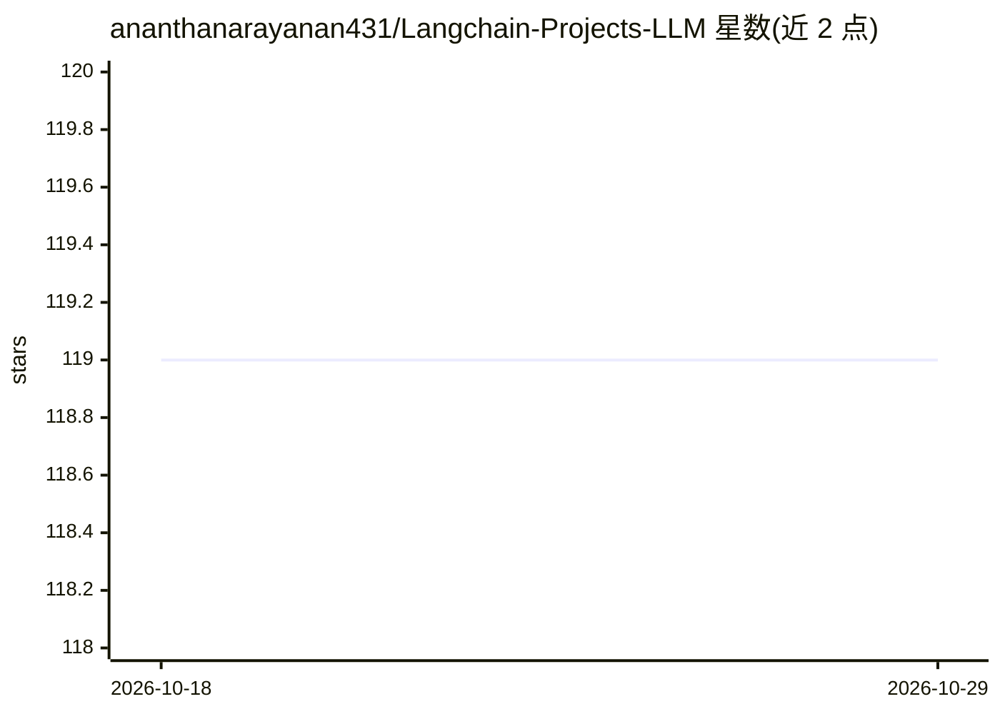

# ananthanarayanan431/Langchain-Projects-LLM

⭐ 119 · Jupyter Notebook · Unlicense · 推送 2026-10-25 · [GitHub](https://github.com/ananthanarayanan431/Langchain-Projects-LLM) · 个人维护

**基于 LangChain 的 LLM 示例项目集合（GPT/LLAMA/HuggingFace）**

一个收录多个大语言模型示例工程的代码仓库，涉及 GPT 与 LLAMA 模型，以及来自 HuggingFace 的开源模型；README 说明运行多数模型需要 OpenAI API。仓库主题标签包含 langchain、llama-index、llm、python，面向希望参考 LangChain 与 LlamaIndex 集成示例的开发者。README 仅两行，未提供具体项目清单、安装命令或运行说明，细节需查看仓库代码目录。

## 筛选速览

| 维度 | 判定 | 备注 |
|---|---|---|
| AI 角色 | `ai-knowledge` | 知识聚合/清单类 |
| 许可风险 | `permissive` | Unlicense |
| 部署形态 | `None` |  |
| 模型依赖 | — | README 未给出锁定关系 |
| 硬件要求 | — | 无带数字的原话,不猜 |
| 安装摩擦 | `low` | 无编译、无系统依赖或容器化 |
| 成熟度 | — | 结构信号不足 |

## 能力要点

- 收录多个使用 GPT 与 LLAMA 的 LLM 项目
- 涉及 HuggingFace 开源模型与 OpenAI API
- 主题覆盖 langchain 与 llama-index

## 适用场景

- 参考 LangChain 调用 GPT/LLAMA 的示例代码
- 学习 LLM 应用项目结构
- 查找 HuggingFace 开源模型的使用示例

## 场景标签

`教程课程` · 领域:学习与行业

## 证据(README 行号)

> L1: # Langchain-Projects-LLM
> L2: Various projects using Large Language Model (GPT &amp; LLAMA) other open source model from HuggingFace and OpenAI. O

## 星数曲线

2026-10-18 119 → 2026-10-29 119（+0）

---
*卡片 v1 · prompt 1.4 · 生成 2026-10-23 · 置信度 mid · 依据 README sha `cfa0de59a9fc` · [字段定义](../../DATASET.md)*
