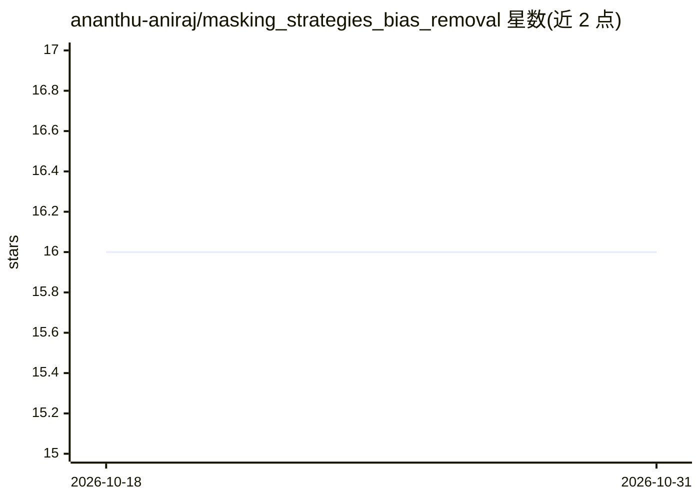

# ananthu-aniraj/masking_strategies_bias_removal

⭐ 16 · Python · MIT · 推送 2026-09-15 · [GitHub](https://github.com/ananthu-aniraj/masking_strategies_bias_removal) · [官网](https://ananthu-aniraj.github.io/masking_strategies_bias_removal/) · 个人维护

**ICCVW 2023 论文官方实现：细粒度分类的背景偏差掩码策略**

论文 "Masking Strategies for Background Bias Removal in Computer Vision Models"（ICCVW-OODCV 2023）的官方代码实现。针对细粒度图像分类模型将类别与栖息地背景关联产生偏差的问题，提出两种掩码策略：在输入图像层移除背景的 early masking，以及选择性掩码高层空间特征的 late masking。基于 Python 3.11 与 PyTorch 2.0.0，使用 CUB-200-2011 训练、Waterbirds 做 OOD 评测，依赖 MMSegmentation 训练分割模型，提供 conda environment.yml 配置环境。

## 筛选速览

| 维度 | 判定 | 备注 |
|---|---|---|
| AI 角色 | `ai-native` | 本体是模型或模型工具 |
| 许可风险 | `permissive` | MIT |
| 部署形态 | `None` |  |
| 模型依赖 | — | README 未给出锁定关系 |
| 硬件要求 | — | 无带数字的原话,不猜 |
| 安装摩擦 | `low` | 无编译、无系统依赖或容器化 |
| 成熟度 | — | 结构信号不足 |

## 能力要点

- early masking（图像级）与 late masking（特征级）两种背景偏差去除策略
- 覆盖 CNN 与 ViT 骨干网络在 OOD 背景下的评测
- 含分割模型训练代码，可复现掩码数据集
- 提供预训练分割模型下载以复现实验

## 适用场景

- 复现论文中的掩码策略与 OOD 评测实验
- 研究细粒度分类模型的背景偏差问题
- 基于 CUB/Waterbirds 数据集做 OOD 泛化实验

## 场景标签

`图像视频处理` `模型训练` · 领域:感知与多模态

## 证据(README 行号)

> L3: Official implementation of the paper: Masking Strategies for Background Bias Removal in Computer Vision Models, acce
> L13: Models for fine-grained image classification tasks, where the difference between some classes can be extremely subt

## 星数曲线

2026-10-18 16 → 2026-10-31 16（+0）

---
*卡片 v1 · prompt 1.4 · 生成 2026-10-30 · 置信度 high · 依据 README sha `c5c196a4f931` · [字段定义](../../DATASET.md)*
