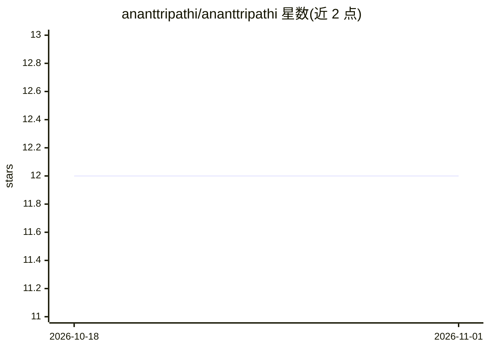

# ananttripathi/ananttripathi

⭐ 12 · MIT · 推送 2026-09-30 · [GitHub](https://github.com/ananttripathi/ananttripathi) · [官网](https://ananttripathi.github.io/ananttripathi/) · 个人维护

**ML/AI 工程师个人 GitHub 主页：展示项目、技能与求职意向**

个人 GitHub Profile README，非可安装软件：展示作者（Bengaluru 的 Senior ML & AI Engineer，Axtria 任职）的技能栈（ML/GenAI/MLOps/云）、职业经历与成果指标，并链接约 15 个项目，涵盖 MLOps 流水线、医学 RAG 问答、HR 政策机器人、肺炎 X 光检测、营销组合建模、简历 ATS 优化、学习路线图与作品集网站等。页面声明开放 Senior ML/AI 岗位与咨询机会，附 LinkedIn/Kaggle/HuggingFace 等联系方式。

## 筛选速览

| 维度 | 判定 | 备注 |
|---|---|---|
| AI 角色 | `ai-knowledge` | 知识聚合/清单类 |
| 许可风险 | `permissive` | MIT |
| 部署形态 | `None` |  |
| 模型依赖 | — | README 未给出锁定关系 |
| 硬件要求 | — | 无带数字的原话,不猜 |
| 安装摩擦 | `low` | 无编译、无系统依赖或容器化 |
| 成熟度 | — | 结构信号不足 |

## 能力要点

- 链接约 15 个项目：MLOps 流水线、RAG 机器人、CV 检测、营销建模等
- 分栏列出技能栈：ML 框架、GenAI/LLM、MLOps 与云平台、数据工程
- 含 Currently Building 与 Program Portfolios 项目索引表

## 适用场景

- 招聘方或合作方了解作者的 AI/ML 项目与经历
- 查找作者开源项目（RAG、MLOps、CV 等）的仓库与在线 Demo 入口
- 了解 AI 工程师职业路线与学习资源

## 场景标签

 · 领域:个人作品集/职业展示

## 证据(README 行号)

> L39: I'm a **Senior ML & AI Engineer** with **5+ years** of experience building production-grade AI solutions across **L
> L135: ## 🚀 Featured Projects

## 星数曲线

2026-10-18 12 → 2026-11-01 12（+0）

---
*卡片 v1 · prompt 1.4 · 生成 2026-11-01 · 置信度 mid · 依据 README sha `e62f44f66a06` · [字段定义](../../DATASET.md)*
