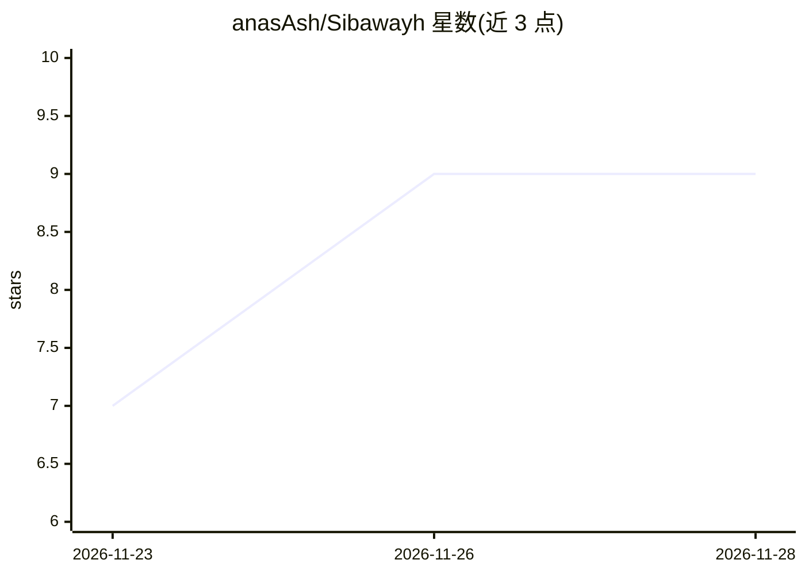

# anasAsh/Sibawayh

⭐ 9 · Python · NOASSERTION · 推送 2026-11-26 · [GitHub](https://github.com/anasAsh/Sibawayh) · 个人维护

**让 AI agent 写出规范阿拉伯语并在回答前自查的技能与校对器**

提供一份 SKILL.md 格式的阿拉伯语写作技能与一个零依赖的 Python 校对脚本：agent 写阿拉伯语前加载规则（动词前置句、一致关系、阿拉伯标点、统一数字体系、RTL 安全行），再用 check_arabic.py 自动修复确定性问题并标记其余项，最后按 7 项清单复核后输出。支持作为 Claude Code 插件安装，也兼容 Cursor、GitHub Copilot 等支持 SKILL.md 格式的 agent。脚本可脱离 agent 单独用于文件校对或 CI（--json）。评估基于 AI 评审盲测与两个人工标注语料库，母语者评审仍在计划中。

## 筛选速览

| 维度 | 判定 | 备注 |
|---|---|---|
| AI 角色 | `ai-native` | 本体是模型或模型工具 |
| 许可风险 | `permissive` | NOASSERTION |
| 部署形态 | `None` |  |
| 模型依赖 | — | README 未给出锁定关系 |
| 硬件要求 | — | 无带数字的原话,不猜 |
| 安装摩擦 | `low` | 无编译、无系统依赖或容器化 |
| 成熟度 | — | 结构信号不足 |

## 能力要点

- SKILL.md 写作规则 + Python 校对脚本 + 7 项复核清单的三段工作流
- 校对脚本零依赖，仅需 Python 3.8+，支持 --fix/--json/CI 集成
- 覆盖拼写、hamza、标点、数字混用、RTL、方言泄漏、翻译腔等类别
- 维护Golden rule：不标记开罗阿拉伯语科学院认可或有争议的形式

## 适用场景

- 让 Claude Code 等 agent 写阿拉伯语回答、文档、邮件时自动自查
- 在 CI 中用脚本校对仓库里的阿拉伯语文本文件
- 为阿拉伯语技术写作统一 API 等术语的阿语译法

## 场景标签

`AI 写作` · 领域:内容生成

## 证据(README 行号)

> L14: An open-source Agent Skill (`SKILL.md`) and Arabic spelling, grammar and punctuation checker. It makes Claude Code,
> L82: 2. **Check.** It runs a tiny Python script with no dependencies. The script auto-fixes what is certain and flags th
> L187: **Can I use the checker without an AI agent?**

## 星数曲线

2026-11-23 7 → 2026-11-28 9（+2）

---
*卡片 v1 · prompt 1.4 · 生成 2026-11-23 · 置信度 high · 依据 README sha `268923af3aea` · [字段定义](../../DATASET.md)*
