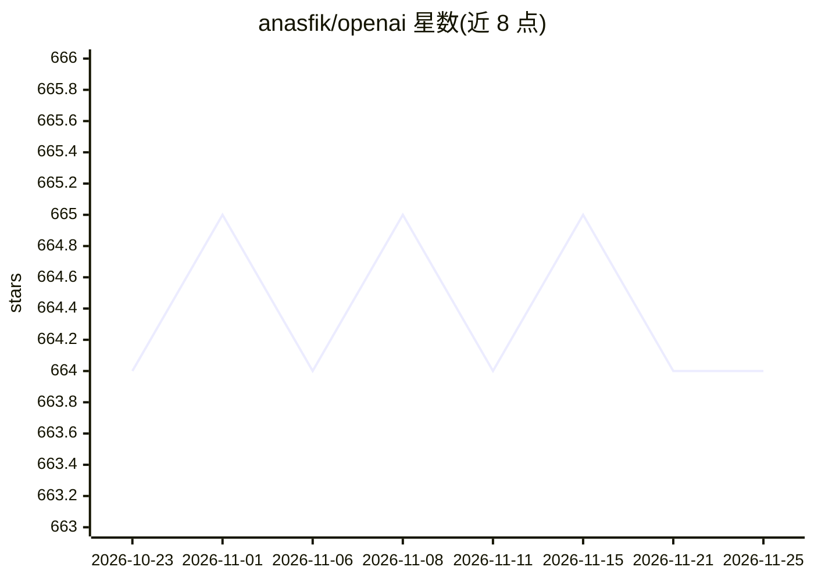

# anasfik/openai

⭐ 664 · Dart · MIT · 推送 2026-11-23 · [GitHub](https://github.com/anasfik/openai) · [官网](https://pub.dev/packages/dart_openai) · 个人维护

**给 Dart/Flutter 开发者的类型化 OpenAI API SDK**

非官方的 Dart/Flutter SDK，为 OpenAI API 的主要接口面提供类型化客户端，覆盖 Responses、Chat Completions、Realtime、视频、Batch、微调、向量存储、评测、管理等。支持 SSE 流式（统一的流引擎与空闲看门狗）、瞬时失败自动重试（指数退避 + Retry-After 优先）、配额可观察、跨 provider 错误格式归一化。每个客户端实例可独立配置 apiKey/baseUrl，可并行接入 Azure 或 OpenAI 兼容 provider。通过 pub 安装，测试全部基于 mock HTTP，无需 API key。

## 筛选速览

| 维度 | 判定 | 备注 |
|---|---|---|
| AI 角色 | `ai-ecosystem` | LLM/agent 周边工具 |
| 许可风险 | `permissive` | MIT |
| 部署形态 | `None` |  |
| 模型依赖 | local-ok | 支持本地模型 |
| 硬件要求 | — | 无带数字的原话,不猜 |
| 安装摩擦 | `low` | 无编译、无系统依赖或容器化 |
| 成熟度 | — | 结构信号不足 |

## 能力要点

- 类型化客户端覆盖 Responses/Chat/Realtime/Videos/Batch/微调等 API 面
- 统一 SSE 流引擎：[DONE] 关闭、空闲超时异常而非挂起
- 自动重试策略（GET 全重试，POST 限流/5xx 重试）与配额元数据可读
- 平台中立文件类型，同一代码可在 web 上运行

## 适用场景

- 在 Flutter 应用中调用 OpenAI 聊天/图像/音频接口
- 接入 DeepSeek、Ollama 等 OpenAI 兼容后端
- 运行批量任务、微调作业与向量存储管理

## 场景标签

 · 领域:LLM 基础设施/SDK

## 证据(README 行号)

> L9: Unofficial Dart/Flutter SDK for the OpenAI API. Typed clients for every major API surface: Responses, Chat Completio
> L53: Works with any provider that implements the OpenAI wire format: DeepSeek, LM Studio, Ollama, Groq, Together, Azure 

## 星数曲线

2026-10-23 664 → 2026-11-25 664（+0）

---
*卡片 v1 · prompt 1.4 · 生成 2026-11-25 · 置信度 high · 依据 README sha `a00c1b2f9eff` · [字段定义](../../DATASET.md)*
