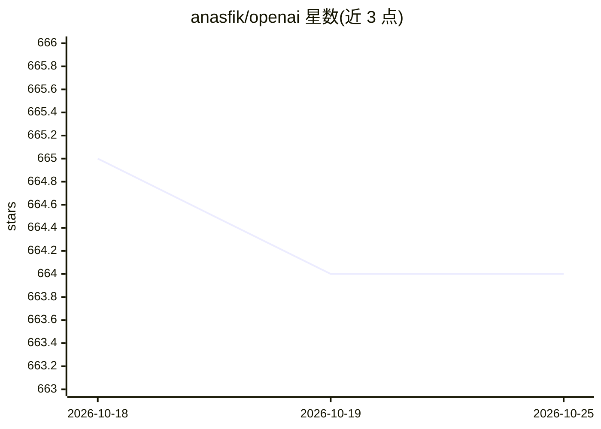

# anasfik/openai

⭐ 664 · Dart · MIT · 推送 2026-08-25 · [GitHub](https://github.com/anasfik/openai) · [官网](https://pub.dev/packages/dart_openai) · 个人维护

**Dart/Flutter 的非官方 OpenAI SDK，覆盖全 API 并兼容多家提供商**

面向 Dart 与 Flutter 开发者的 OpenAI API 客户端库（dart_openai），为 Responses、Chat Completions、Realtime、Videos、Batch、Fine-tuning、Vector Stores、Evals、Administration 等 API 表面提供类型化客户端。支持多客户端实例并运行多个账号或 OpenAI 兼容提供商（DeepSeek、LM Studio、Ollama、Groq、Azure 等实现 OpenAI wire format 即可）。内置统一 SSE 流式引擎、自动重试（指数退避、遵循 Retry-After）、跨提供商错误归一化与类型化异常。上传采用平台无关文件类型，同一代码可在 Android/iOS/macOS/Linux/Windows/Web/服务端 Dart 运行。MIT 许可，由个人维护。

## 筛选速览

| 维度 | 判定 | 备注 |
|---|---|---|
| AI 角色 | `ai-ecosystem` | LLM/agent 周边工具 |
| 许可风险 | `permissive` | MIT |
| 部署形态 | `None` |  |
| 模型依赖 | local-ok | 支持本地模型 |
| 硬件要求 | — | 无带数字的原话,不猜 |
| 安装摩擦 | `low` | 无编译、无系统依赖或容器化 |
| 成熟度 | — | 结构信号不足 |

## 能力要点

- 覆盖 Responses/Chat/Realtime/Videos/Batch/Fine-tuning/Evals/Administration 等 API 表面的类型化客户端
- 多客户端实例并行使用多个账号或 OpenAI 兼容提供商（DeepSeek/LM Studio/Ollama/Groq/Azure 等）
- 统一 SSE 流式引擎：[DONE] 关闭、事件不重复、错误以异常抛出，并带空闲看门狗
- 自动重试（408/429/5xx，指数退火+jitter）与跨提供商错误归一化

## 适用场景

- 在 Flutter 或 Dart 服务端应用中调用 OpenAI 各类 API
- 同一应用内切换或并行使用 DeepSeek、Ollama、Azure 等兼容提供商
- 构建流式对话、图像生成或 Realtime 会话功能

## 场景标签

`模型网关` · 领域:Agent 开发

## 证据(README 行号)

> L9: Unofficial Dart/Flutter SDK for the OpenAI API. Typed clients for every major API surface: Responses, Chat Completio
> L51: Works with any provider that implements the OpenAI wire format: DeepSeek, LM Studio, Ollama, Groq, Together, Azure 

## 星数曲线

2026-10-18 665 → 2026-10-25 664（-1）

---
*卡片 v1 · prompt 1.4 · 生成 2026-10-21 · 置信度 high · 依据 README sha `178c12fd1f8e` · [字段定义](../../DATASET.md)*
