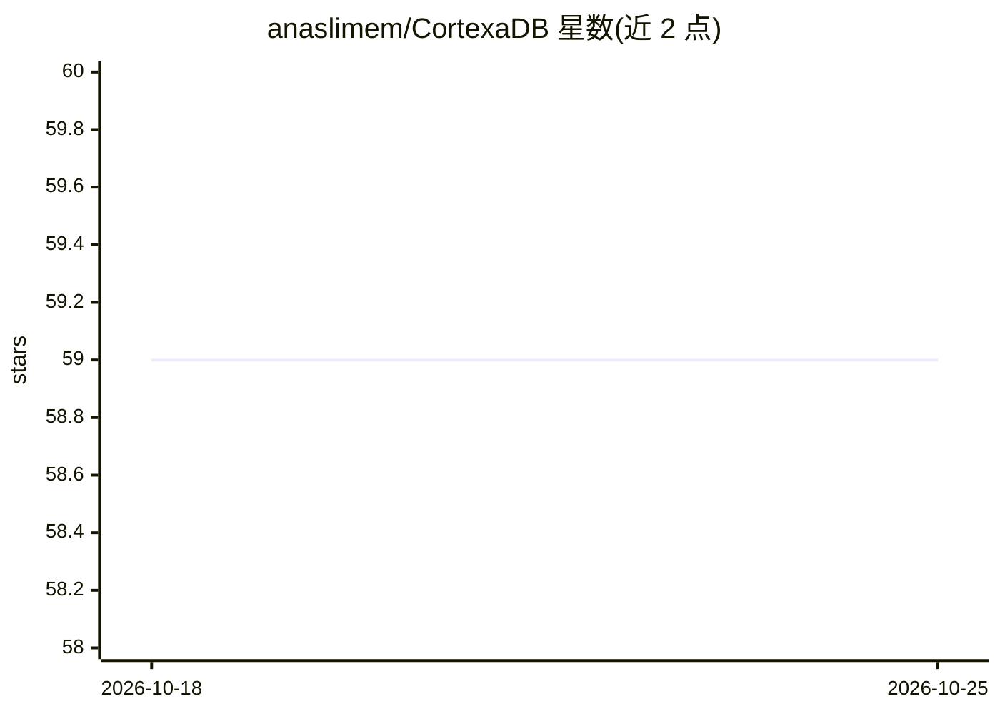

# anaslimem/CortexaDB

⭐ 59 · Rust · Apache-2.0 · 推送 2026-06-12 · [GitHub](https://github.com/anaslimem/CortexaDB) · [官网](https://cortexa-db.vercel.app) · 个人维护

**面向 AI agent 记忆的嵌入式向量/图/时序数据库**

Rust 编写、Python 可用的嵌入式数据库，作为 AI agent 的长期记忆存储：无需服务器，单文件零依赖运行在 agent 进程内，同时支持向量语义检索、图关系与时间近近度三种混合查询。索引采用 HNSW（USearch），存储由 WAL 支持以保证持久性，数据完全本地。README 给出 M 系列 Mac 上 10,000×384 维嵌入的基准数据。Python 经 PyPI 安装，Rust 经 Cargo 添加。

## 筛选速览

| 维度 | 判定 | 备注 |
|---|---|---|
| AI 角色 | `ai-ecosystem` | LLM/agent 周边工具 |
| 许可风险 | `permissive` | Apache-2.0 |
| 部署形态 | `library` | 以包/库形式分发 |
| 模型依赖 | — | README 未给出锁定关系 |
| 硬件要求 | — | 无带数字的原话,不猜 |
| 安装摩擦 | `low` | 无编译、无系统依赖或容器化 |
| 成熟度 | — | 结构信号不足 |

## 能力要点

- 单文件零依赖嵌入式运行，无需服务器
- 向量+图+时间三路混合检索的链式 QueryBuilder
- HNSW（USearch）索引，README 基准称批量摄入 5,000+ chunks/秒
- WAL 支持的本地存储，可选 PDF/Docx 解析扩展

## 适用场景

- 给 AI agent 提供跨会话的长期记忆存储
- 替代需要独立服务器部署的向量数据库做轻量方案
- 对记忆同时做语义相似、关系结构与时序新近度检索

## 场景标签

`Agent 记忆` `向量数据库` · 领域:Agent 开发

## 证据(README 行号)

> L16: **CortexaDB** is a lightweight, high-performance embedded database built in Rust, specifically designed to serve as
> L22: CortexaDB exists to provide a **middle ground**: a hard-durable, embedded memory engine that runs inside your agent

## 星数曲线

2026-10-18 59 → 2026-10-25 59（+0）

---
*卡片 v1 · prompt 1.4 · 生成 2026-10-24 · 置信度 high · 依据 README sha `a311c46ec937` · [字段定义](../../DATASET.md)*
