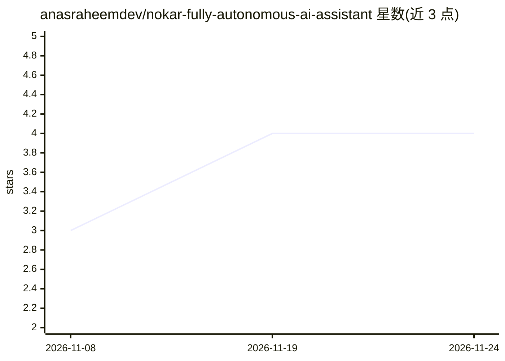

# anasraheemdev/nokar-fully-autonomous-ai-assistant

⭐ 4 · Python · NOASSERTION · 推送 2026-10-24 · [GitHub](https://github.com/anasraheemdev/nokar-fully-autonomous-ai-assistant) · 组织维护

**开源全自主 AI 桌面助手：语音+视觉+桌面自动化**

基于 Google Gemini Live API 与 PyQt6 构建的桌面助手，提供实时双向语音对话、屏幕截图问答、前台应用上下文注入、文件/邮件/系统监控等桌面自动化能力，内置 9 模型故障回退梯、本地 TF-IDF 文档检索（RAG Vault）、危险操作确认门与通用撤销。数据与密钥本地存储，无集中遥测；语音仅在交互时流式传至 Gemini 端点。支持 Windows/macOS/Linux，源码运行，需自备 Gemini API Key。许可证为 CC BY-NC 4.0，商业用途需向 Obrix Labs 获取授权。

## 筛选速览

| 维度 | 判定 | 备注 |
|---|---|---|
| AI 角色 | `ai-native` | 本体是模型或模型工具 |
| 许可风险 | `none` | NOASSERTION |
| 部署形态 | `library` | 以包/库形式分发 |
| 模型依赖 | — | README 未给出锁定关系 |
| 硬件要求 | `cpu-ok` | |
| 安装摩擦 | `low` | 无编译、无系统依赖或容器化 |
| 成熟度 | — | 结构信号不足 |

## 能力要点

- Gemini Live 实时双向语音对话与口型同步
- 9 模型自动故障回退梯（429/503/504 冷却机制）
- 本地文档 TF-IDF/cosine 检索索引（.py/.md/.pdf 等）
- 危险操作硬件确认门与跨语言 "undo" 撤销

## 适用场景

- 看 IDE 报错时按 F9 让助手截屏讲解解决方案
- 早晨开机获得天气、邮件、项目进度的语音简报
- 语音免手操作桌面：打开应用、调音量、整理文件
- 把 PDF 或项目文件夹丢进界面，对话检索本地文档

## 场景标签

`AI 助手` `GUI 自动化` `RAG` · 领域:效率与自动化

## 证据(README 行号)

> L24: **NOKAR** is a production-ready, open-source, fully autonomous **AI desktop assistant** engineered to give you comp
> L26: Unlike traditional text-based chatbots or rigid voice wrappers, NOKAR functions as a true **agentic desktop assista
> L108: |**AI & Multimodal Models**|Google Gemini Live API, Gemini 3.5 Flash, Gemini 2.5 Flash|

## 星数曲线

2026-11-08 3 → 2026-11-24 4（+1）

---
*卡片 v1 · prompt 1.4 · 生成 2026-11-21 · 置信度 high · 依据 README sha `1fdf7d4249db` · [字段定义](../../DATASET.md)*
