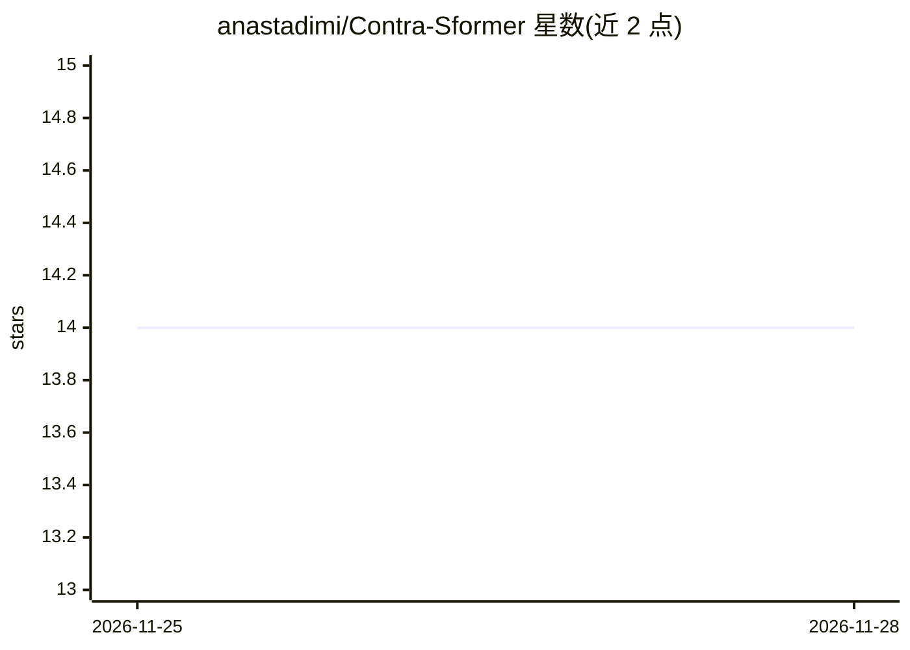

# anastadimi/Contra-Sformer

⭐ 14 · Python · 推送 2026-11-23 · [GitHub](https://github.com/anastadimi/Contra-Sformer) · 个人维护

**机器人手术技能评估的对比回归 Transformer 论文代码**

论文 Keep Your Eye on the Best 的官方代码实现：通过对比测试视频与参考手术视频，输出手术技能评分回归结果。架构由 ResNet-18 空间分支（帧级手势标签监督）+ TCN 时间分支提取特征，经动作感知 Transformer（A-Transformer）生成帧级跨视频对比特征。提供 env.yaml 环境文件、预提取特征包（邮件索取）、交叉验证划分文件与 .pth 预训练模型，支持 knot_tying/needle_passing/suturing 三个任务与 loso/louo/4fold 三种验证方案，在 JIGSAWS 数据集上验证。

## 筛选速览

| 维度 | 判定 | 备注 |
|---|---|---|
| AI 角色 | `ai-native` | 本体是模型或模型工具 |
| 许可风险 | `none` | — |
| 部署形态 | `desktop` | 安装包/桌面程序 |
| 模型依赖 | — | README 未给出锁定关系 |
| 硬件要求 | — | 无带数字的原话,不猜 |
| 安装摩擦 | `low` | 无编译、无系统依赖或容器化 |
| 成熟度 | — | 结构信号不足 |

## 能力要点

- ResNet-18 + TCN + 动作感知 Transformer 的对比回归架构
- 提供预提取特征、划分文件与 .pth 预训练模型
- 支持 3 个任务 × 3 种交叉验证方案的训练与评估脚本
- 无需显式错误标注即可编码次优执行信息

## 适用场景

- 复现 RA-L 2023 论文的手术技能评估实验
- 在 JIGSAWS 数据集上训练技能评分模型
- 为手术培训场景研究生徒反馈机制

## 场景标签

 · 领域:医疗/手术机器人与视频分析

## 证据(README 行号)

> L10: regression architecture, Contra-Sformer, for automated
> L23: Sformer achieves competitive performance (Spearman Correlation 0.65 -
> L60: To train and evaluate the model, simply run experiment.py and specify the task (knot_tying/needle_passing/suturing)

## 星数曲线

2026-11-25 14 → 2026-11-28 14（+0）

---
*卡片 v1 · prompt 1.4 · 生成 2026-11-24 · 置信度 high · 依据 README sha `6be2a57d408a` · [字段定义](../../DATASET.md)*
