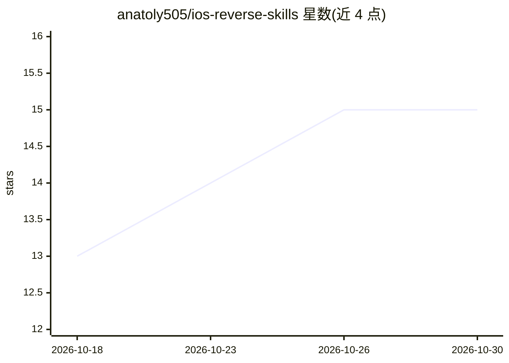

# anatoly505/ios-reverse-skills

⭐ 15 · Shell · Unlicense · 推送 2026-05-06 · [GitHub](https://github.com/anatoly505/ios-reverse-skills) · 个人维护

**多 LLM 适配的 iOS 逆向工程技能包：14 阶段工作流**

面向 LLM 编码代理的 iOS 逆向工具包，从 incogbyte/iOS-reverse-engineering-claude-skill 分支并扩展：将工作流重构为模型无关的 METHODOLOGY.md，从 10 阶段扩展到 14 阶段（分诊、解密、静态分析、动态插桩、漏洞审计、二进制补丁），新增 6 个 bash 脚本、2 个 Ghidra 脚本与 21 份参考文档，并为 Claude Opus/Code、Cursor、Qwen Coder、MiniMax、Codex/GPT-5、Aider、Cline 等提供安装适配器。处理 IPA/.app/Mach-O 等输入，产出 API 文档、安全发现、SDK 指纹与渗透测试报告。必需依赖为 ipsw、otool、strings、unzip；Linux 仅支持静态分析。

## 筛选速览

| 维度 | 判定 | 备注 |
|---|---|---|
| AI 角色 | `ai-ecosystem` | LLM/agent 周边工具 |
| 许可风险 | `permissive` | Unlicense |
| 部署形态 | `None` |  |
| 模型依赖 | locked-api |  |
| 硬件要求 | — | 无带数字的原话,不猜 |
| 安装摩擦 | `low` | 无编译、无系统依赖或容器化 |
| 成熟度 | — | 结构信号不足 |

## 能力要点

- 14 阶段（0-13）模型无关逆向工作流，覆盖分诊到二进制补丁
- 为 7 类以上 LLM 编码代理提供 install.sh 适配安装
- 内置 Ghidra/radare2/rizin/Frida 分析脚本与 SSL pinning bypass 等 Frida 脚本包
- 0-20 分保护检测评分与漏洞类审计（含攻击链叙述）

## 适用场景

- iOS 应用上线前安全审计与渗透测试
- CTF 中 iOS 二进制的快速分诊
- 分析竞品应用的 SDK、API 与架构
- 可疑 IPA 的应急响应评估

## 场景标签

`网络安全` · 领域:学习与行业

## 证据(README 行号)

> L15: - Refactors the workflow into a model-agnostic
> L40: - Adds adapters for every major LLM coding agent.
> L107: |Agent|One-liner|

## 星数曲线

2026-10-18 13 → 2026-10-30 15（+2）

---
*卡片 v1 · prompt 1.4 · 生成 2026-10-30 · 置信度 high · 依据 README sha `8fa203c7afde` · [字段定义](../../DATASET.md)*
